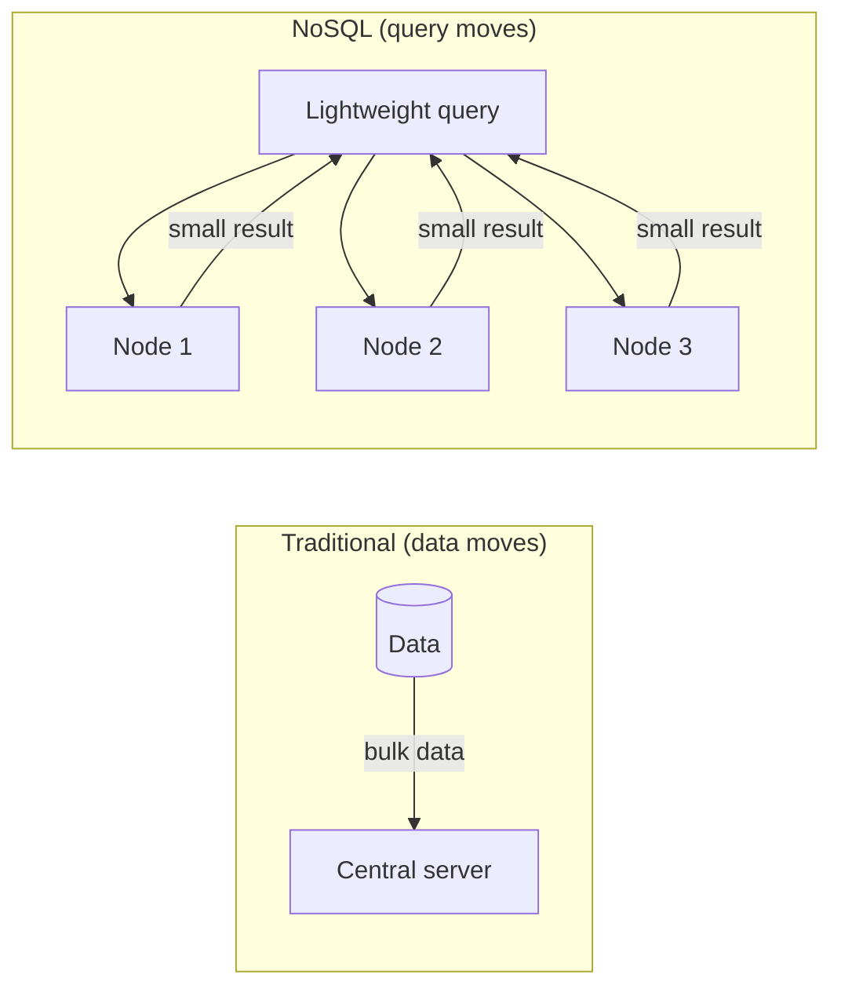
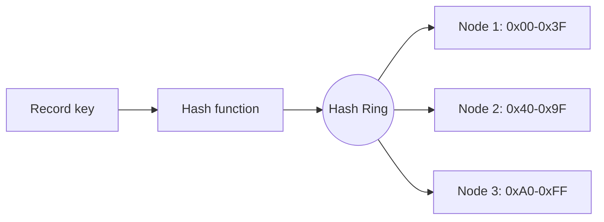
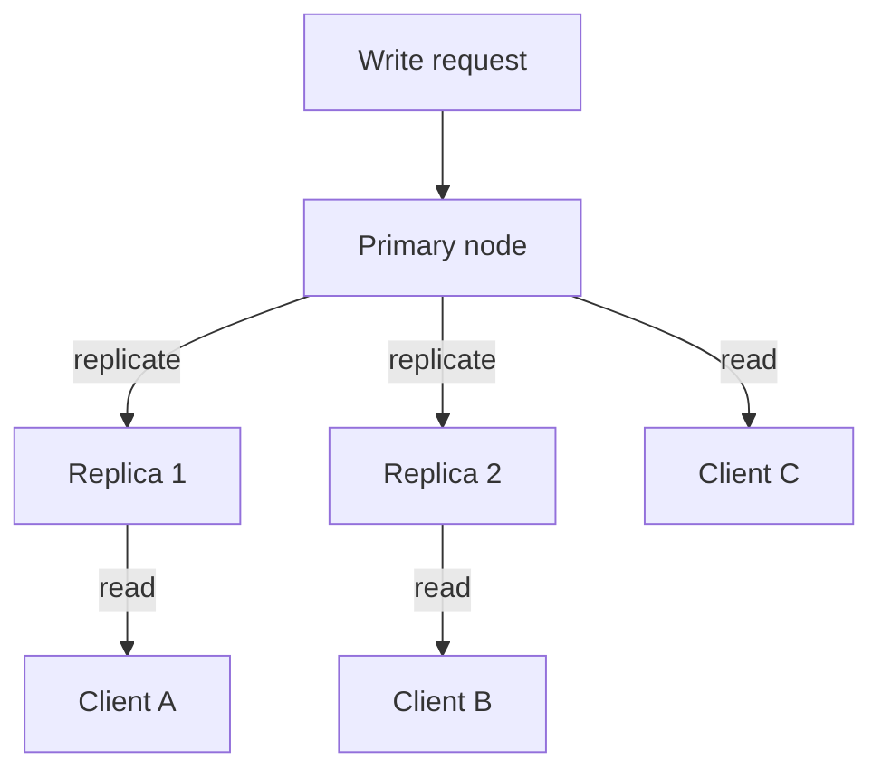
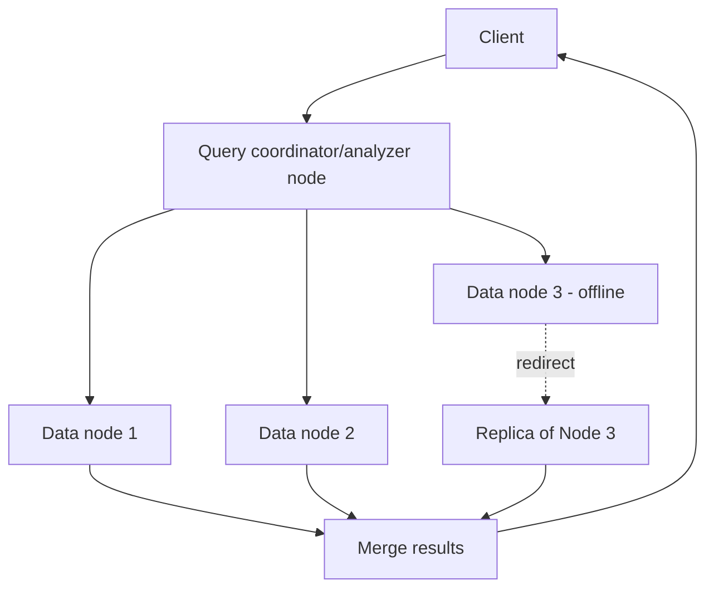

---
tags:
  - databases
  - nosql
  - distributed-systems
  - big-data
  - exam-notes
---

# How NoSQL Handles Big Data: Four Core Strategies

## 1. Introduction

Traditional relational databases scale **vertically** (a bigger single server), which eventually hits a bottleneck for massive datasets. **NoSQL systems are architected from the ground up for distribution**, spreading data and work across many **commodity servers**. They handle Big Data challenges through **four core operational strategies**:

1. Moving queries to the data, not data to the queries
2. Using hash rings to evenly distribute data
3. Using replication to scale reads
4. Letting the database distribute queries evenly to data nodes

> [!important] One-line answer
> NoSQL scales **horizontally** across commodity servers by sending queries to where data lives, hashing data evenly across nodes, replicating data for fast reads, and using coordinator nodes to fan out and merge distributed queries.

---

## 2. Strategy 1: Moving Queries to the Data, Not Data to the Queries

### Concept

- Most NoSQL systems use a **shared-nothing architecture**: independent commodity servers, each storing a **distinct subset** of the dataset on its own local disk.
- Exception: some large **graph databases** don't follow this model as strictly.

### The Problem in Traditional Databases

- A large analytical query often pulls **massive volumes of data across the network** to one central server.
- This **saturates network bandwidth** and slows performance.

### The NoSQL Solution

- **Reverse the model:** send the **lightweight query** directly to every node that holds relevant data.
- Each node stores related data together in **self-contained logical units** (documents, column families).
- **Processing happens locally** on each machine.
- Only the **compact query** and the **final filtered results** travel across the network.

### Benefit

Drastically **reduced latency**, making Big Data queries significantly faster.

---

## 3. Strategy 2: Using Hash Rings to Evenly Distribute Data

### The Problem

- Deciding **which server stores which record** so no single node is overloaded while others sit idle.

### The Solution: Consistent Hashing with a Hash Ring

1. A new record/document enters the cluster.
2. The system generates a **hash value** (e.g., a 40-character hexadecimal key).
3. The **leading bits** of the hash deterministically map the data to a **specific node on the ring**.
4. The total key range is split into segments, each assigned to a server. This is called **keyspace management**.

### Key Properties

| Property | Explanation |
|---|---|
| **Deterministic mapping** | Every node in the cluster **immediately knows** which server owns any given piece of data |
| **Even distribution** | Hashing spreads records roughly evenly, avoiding hot/overloaded nodes |
| **Elastic scaling** | When new servers are added, the ring **automatically adapts** and redistributes key ranges with **minimal data movement** |

### Benefit

Scalable, self-balancing storage that grows smoothly as the cluster grows.

---

## 4. Strategy 3: Using Replication to Scale Reads

### Why Replication

- Big Data applications typically see **far more reads than writes**.
- NoSQL databases use **real-time replication**: multiple live backup copies of data on separate nodes.

### How It Works

- **Writes** go to designated **read/write (primary) nodes**.
- **Reads** are spread across **all replica nodes** simultaneously.

### Benefits

- **High read throughput** (horizontal scaling of reads)
- **Fault tolerance** (if one node fails, replicas keep serving data)

### The Trade-off: Replication Lag

- Background sync from primary to replicas takes time.
- If a client **writes** to the primary and **immediately reads** from a replica **before sync completes**, it may get **outdated (stale) data**.
- This is called an **inconsistent read**.

> [!note] Why this happens
> Distributed NoSQL systems **relax strict consistency** to maintain speed (see [[CAP-Theorem-vs-ACID]] — this is the **AP** side of the CAP theorem).

### Application-Level Fix

- Applications needing **immediate read-after-write consistency** solve it themselves, e.g. using **session/state management** to route a user's immediate post-write reads **back to the same write node**.

---

## 5. Strategy 4: Letting the Database Distribute Queries Evenly to Data Nodes

### Goal

High performance for queries that **span multiple servers**, without forcing the client to track where data lives.

### How It Works

1. Client requests go to dedicated **query analyzer / coordinator nodes**.
2. The coordinator **fans out** the query to **every relevant data node in parallel**.
3. Each data node evaluates the query **locally** and returns matching records.
4. If a data node is **offline**, the system **redirects** that part of the query to one of its **replicas**.
5. The coordinator **merges** all partial results into a single response for the user.

### Key Idea: Federated Search

- This mirrors **federated search**: a single query is distributed across multiple independent servers.
- The combined output gives the user the **seamless impression of querying one unified database**.

### Benefits

- **Transparency:** the client doesn't need to know data placement.
- **Resilience:** offline nodes are bypassed using replicas.
- **Parallelism:** queries run concurrently on all relevant nodes, which is fast even at large scale.

---

## 6. Summary Table

| # | Strategy | Problem Solved | Mechanism | Main Benefit |
|---|---|---|---|---|
| 1 | Move queries to data | Network saturation from moving bulk data | Shared-nothing architecture; send lightweight query to data nodes | Lower latency, faster Big Data queries |
| 2 | Hash rings | Uneven load across servers | Consistent hashing, keyspace management | Even distribution, elastic scaling with minimal data movement |
| 3 | Replication for reads | Read-heavy traffic, server failure | Live replicas; writes to primary, reads from any replica | High read throughput, fault tolerance (trade-off: replication lag) |
| 4 | Distributed query coordination | Client shouldn't need to track data location | Coordinator nodes fan out and merge results (federated search) | Seamless, parallel, resilient querying |

---

## 7. Quick Revision Points

1. NoSQL scales **horizontally** using **commodity servers**, unlike RDBMS vertical scaling.
2. **Shared-nothing architecture:** each node owns a distinct data subset; queries go to the data (not data to a central server).
3. **Consistent hashing / hash ring:** deterministically maps records to nodes; adapts automatically when nodes are added.
4. **Replication:** scales reads and adds fault tolerance, but causes **replication lag** and **inconsistent/stale reads**.
5. Read-after-write consistency is fixed at the **application layer** (session routing to the write node).
6. **Coordinator/analyzer nodes** fan out queries in parallel and **merge** results — similar to **federated search**.
7. Offline data nodes are handled by **redirecting to replicas**.

---

## 8. Sample Exam Answer (Medium Length)

> NoSQL systems are built from the ground up to overcome the scaling limits of single-server relational databases when handling Big Data. They use four core strategies.
>
> First, instead of moving large volumes of data to a central query server (which saturates the network), NoSQL uses a **shared-nothing architecture** and sends the **lightweight query to the data nodes** that hold the relevant data, processing it locally and returning only compact results.
>
> Second, NoSQL evenly distributes records across the cluster using **consistent hashing** and a **hash ring**: each record's hash deterministically maps it to a node, and when new servers are added, the ring **redistributes data with minimal movement**.
>
> Third, since Big Data workloads are read-heavy, NoSQL uses **replication** to scale reads: writes go to a primary node while reads are spread across replicas, improving throughput and fault tolerance, though this introduces **replication lag** and possible **stale reads**, usually fixed at the application layer.
>
> Fourth, NoSQL uses **coordinator/analyzer nodes** to fan out a client's query to all relevant data nodes in parallel, redirect to replicas if a node is offline, and **merge the partial results**, similar to **federated search**, giving the appearance of one unified database.

---

## 9. Likely Exam Questions

1. Explain the four core strategies NoSQL uses to handle Big Data challenges.
2. What is a shared-nothing architecture, and why does NoSQL send queries to data instead of data to queries?
3. Explain consistent hashing and the role of a hash ring in NoSQL data distribution.
4. What is keyspace management?
5. How does replication help scale reads in NoSQL databases? What is replication lag?
6. What is an inconsistent/stale read, and how is it solved at the application layer?
7. Explain the role of query coordinator/analyzer nodes in distributed NoSQL querying.
8. What is federated search, and how does it relate to NoSQL query distribution?
9. 