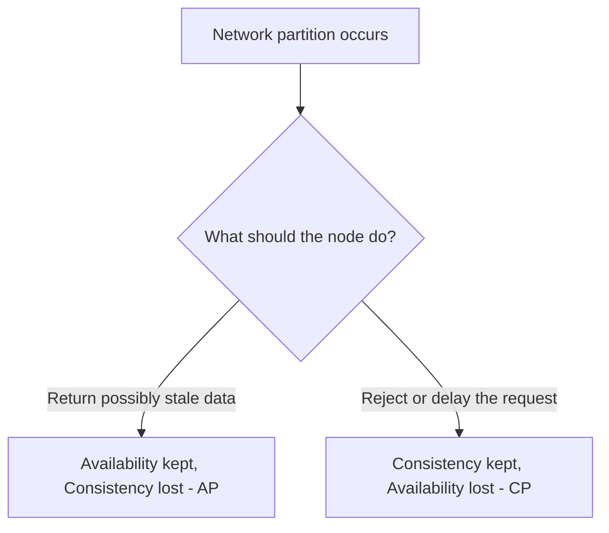
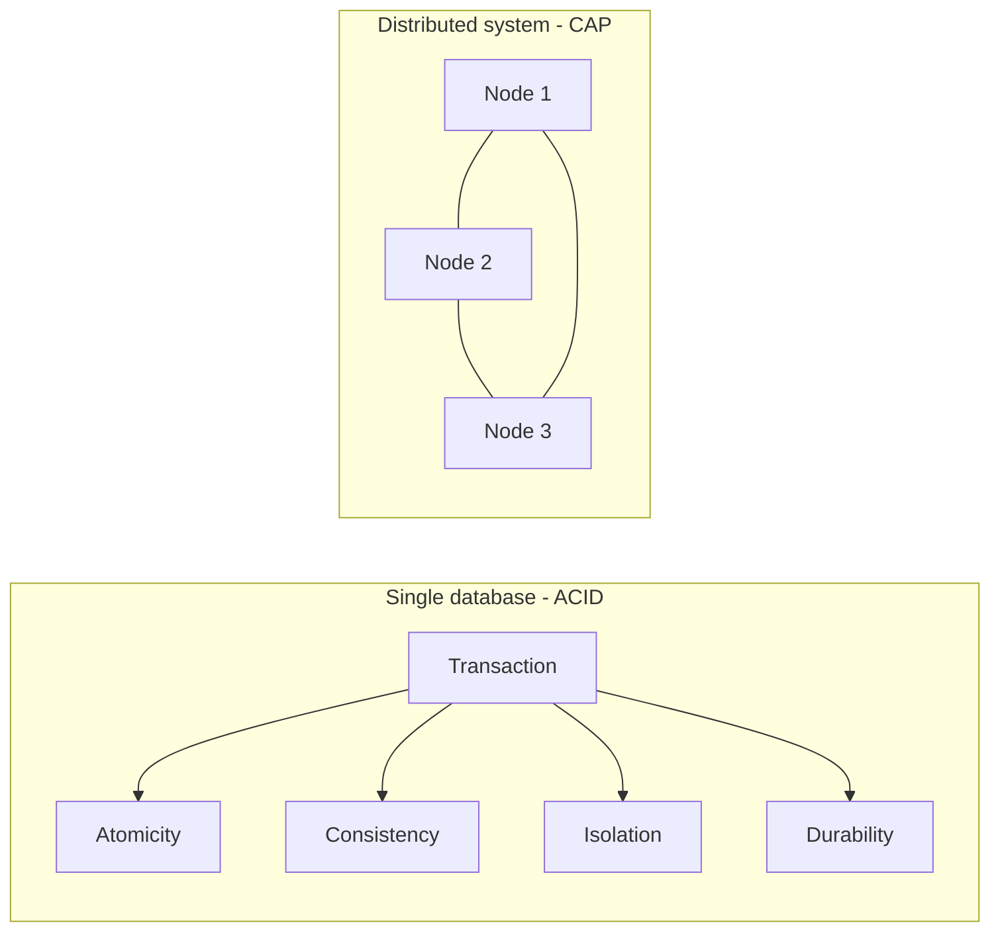

---
tags:
  - acid
  - distributed-systems
  - exam-notes
---

# CAP Theorem and How It Differs from ACID Properties

## 1. Introduction

Modern applications store data across **multiple servers (nodes)** to get speed, scale, and fault tolerance. Traditional databases, however, ran on a **single machine**. Two different frameworks describe what a database can promise:

- **ACID** describes the guarantees of a **transaction** (mainly in single-node relational databases).
- **CAP Theorem** describes the **trade-offs of a distributed system** when the network fails.

> [!important] Core difference in one line
> **ACID** is about **correct transactions** inside a database. **CAP** is about **what a distributed database can promise when the network breaks**.

---

## 2. CAP Theorem

### 2.1 Definition

The **CAP theorem** states that a **distributed data store** can guarantee **at most two out of three** properties at the same time:

- **C**: Consistency
- **A**: Availability
- **P**: Partition Tolerance

More precisely: **when a network partition occurs, the system must choose between Consistency and Availability.**

### 2.2 History

- Proposed by **Eric Brewer** in 2000 (also called **Brewer's Theorem**).
- Formally proved by **Seth Gilbert and Nancy Lynch** in 2002.

### 2.3 The Three Properties

| Property | Meaning | Example |
|---|---|---|
| **Consistency (C)** | Every read receives the **most recent write** (or an error). All nodes show the same data at the same time. | After you update your address, every server returns the new address. |
| **Availability (A)** | Every request to a working node receives a **non-error response**, though it may not contain the most recent write. | The website always responds, even if some data is slightly old. |
| **Partition Tolerance (P)** | The system **keeps working** even if messages between nodes are **dropped or delayed** by the network. | Server A and Server B lose connection, but the system still runs. |

> [!note] What is a partition?
> A **network partition** is a communication failure that splits the nodes into groups that cannot talk to each other. For example, a cable fault between two data centers.

### 2.4 Why Only Two Out of Three?

Imagine a database with two nodes, **Node 1** and **Node 2**, that replicate data to each other.

```text
   Client X ---> [Node 1]   X X X (network failure)   [Node 2] <--- Client Y
```

1. A **partition** happens: Node 1 and Node 2 can no longer communicate.
2. Client X **writes** a new value to Node 1. Node 1 **cannot copy** it to Node 2.
3. Client Y **reads** from Node 2. Node 2 now has two options:
   - **Return its old value:** the system stays **Available**, but the data is **not Consistent**.
   - **Refuse or return an error:** the system stays **Consistent**, but is **not Available**.

There is **no third option**. Therefore **C and A cannot both be guaranteed during a partition**.



### 2.5 Why Partition Tolerance Is Mandatory

- In real distributed systems, **network failures are inevitable** (cable faults, congestion, crashed routers, data center outages).
- A system that is not partition tolerant would simply **fail entirely** when the network breaks.
- Therefore **P is a must**, and the real design choice is **C vs A**.

### 2.6 The Three Combinations

| Type | Guarantees | Sacrifices | Behavior during a partition | Typical use |
|---|---|---|---|---|
| **CP** | Consistency + Partition Tolerance | Availability | Refuses requests or returns errors until nodes sync | Banking, payments, inventory, stock trading |
| **AP** | Availability + Partition Tolerance | Consistency | Responds with possibly stale data, syncs later | Social media feeds, product catalogs, shopping carts, DNS |
| **CA** | Consistency + Availability | Partition Tolerance | Works only if there is **no partition** | Single-node RDBMS (not truly distributed) |

> [!warning] About CA
> A **truly distributed** system cannot be CA, because partitions cannot be avoided. CA is usually cited for **single-node traditional relational databases**, where no network partition exists between nodes.

### 2.7 Examples of Databases

| Category | Examples (commonly cited) |
|---|---|
| **CP** | MongoDB (default configuration), HBase, Redis (cluster, consistency-focused), Google Spanner, Zookeeper |
| **AP** | Cassandra, Amazon DynamoDB, CouchDB, Riak |
| **CA** (single node) | MySQL, PostgreSQL, Oracle (non-distributed setup) |

> [!note]
> Classification can vary with configuration. Many modern databases offer **tunable consistency**, letting you lean toward C or A.

### 2.8 Real-World Examples

- **Banking (CP):** If the network splits, the bank would rather show an error than show a wrong balance or allow double spending.
- **Social media feed (AP):** If you see a friend's like count a few seconds late, nothing serious happens, so the site stays online.
- **E-commerce cart (AP):** Amazon's Dynamo design prefers to always accept "add to cart", and reconciles differences later.

### 2.9 Eventual Consistency and BASE

AP systems usually follow the **BASE** model instead of ACID:

| Letter | Meaning |
|---|---|
| **B**asically **A**vailable | The system is always available, even if some data is stale |
| **S**oft state | Data state may change over time even without new input (while syncing) |
| **E**ventual consistency | If no new updates arrive, all nodes **eventually** hold the same data |

### 2.10 PACELC Extension (for extra marks)

CAP only talks about behavior **during a partition**. **PACELC** extends it:

> If there is a **P**artition, choose between **A**vailability and **C**onsistency; **E**lse (normal operation), choose between **L**atency and **C**onsistency.

Even when there is no failure, stronger consistency costs **higher latency** because replicas must coordinate.

---

## 3. ACID Properties

### 3.1 Definition

**ACID** is a set of four properties that guarantee **reliable processing of database transactions**, even during errors, crashes, or power failures. A **transaction** is a logical unit of work made of one or more operations.

### 3.2 The Four Properties

| Property | Meaning | Banking example (transfer ₹500 from A to B) |
|---|---|---|
| **Atomicity** | A transaction is **all or nothing**. If any step fails, the whole transaction is **rolled back**. | If debiting A succeeds but crediting B fails, the debit is undone. |
| **Consistency** | A transaction moves the database from one **valid state to another**, obeying all **rules and integrity constraints**. | Balance can never become negative; total money stays the same. |
| **Isolation** | **Concurrent** transactions do not interfere; the result is as if they ran **one after another**. | Two transfers on the same account do not corrupt each other's result. |
| **Durability** | Once **committed**, changes are **permanent**, even after a crash or power loss. | After "transfer successful", the data survives a server restart. |

### 3.3 Example in SQL

```sql
BEGIN TRANSACTION;

UPDATE accounts SET balance = balance - 500 WHERE id = 'A';
UPDATE accounts SET balance = balance + 500 WHERE id = 'B';

COMMIT;      -- changes become permanent (Durability)
-- ROLLBACK; -- if any step fails, undo everything (Atomicity)
```

### 3.4 How ACID Is Achieved

- **Atomicity:** transaction logs, undo/rollback.
- **Consistency:** constraints (primary key, foreign key, CHECK), triggers.
- **Isolation:** locking and isolation levels (Read Committed, Repeatable Read, Serializable), MVCC.
- **Durability:** write-ahead logging (WAL), disk persistence, backups.

---

## 4. The Tale of Two Consistencies

> [!important] The most important exam point
> The word **"Consistency"** means **different things** in ACID and CAP.

| | **ACID Consistency** | **CAP Consistency** |
|---|---|---|
| Meaning | Data **integrity** and **business rules** are maintained | All nodes show the **same, latest** data |
| Concern | Is the data **valid**? | Is the data **up to date on every server**? |
| Scope | One transaction, usually one database | Multiple replicas across a network |
| Example | Rejecting a withdrawal that makes the balance negative | Every server returning the latest balance right after a deposit |
| Close to | Integrity constraints | **Linearizability** (strong consistency) |

---

## 5. Difference Between CAP and ACID

| Basis | **ACID** | **CAP Theorem** |
|---|---|---|
| **Nature** | Set of **properties** for transactions | A **theorem** about trade-offs in distributed systems |
| **Focus** | Correctness and reliability of **transactions** | Behavior of **replicated data** during network failure |
| **Level** | Microscopic: individual transactions | Architectural: the whole distributed system |
| **Environment** | Mainly **single-node** relational databases | **Distributed** databases across many nodes |
| **Components** | Atomicity, Consistency, Isolation, Durability | Consistency, Availability, Partition Tolerance |
| **Meaning of Consistency** | Data follows rules and integrity constraints | All nodes return the latest write |
| **Are all guaranteed together?** | Yes, ACID databases aim to provide **all four** | No, only **two of three** can be guaranteed |
| **Availability** | Not a property of ACID | Core property |
| **Network failure** | Not considered | Central concern (Partition Tolerance) |
| **Associated model** | Strong, rigid transactions | CP systems, or AP systems with **BASE** |
| **Typical systems** | MySQL, PostgreSQL, Oracle, SQL Server | MongoDB, Cassandra, DynamoDB, HBase |
| **Best for** | Banking, accounting, order processing | Large-scale web apps, social media, IoT |
| **Trade-off** | Performance and scalability may be lower | Choice between consistency and availability |

---

## 6. ACID vs BASE (Related Comparison)

| ACID | BASE |
|---|---|
| Strong consistency | Eventual consistency |
| Pessimistic: correctness first | Optimistic: availability first |
| Harder to scale horizontally | Scales horizontally easily |
| Used in RDBMS | Used in many NoSQL databases (AP systems) |

---

## 7. Relationship Between ACID and CAP

- They are **not competitors**; they solve problems at **different levels**.
- A distributed database can still offer **ACID transactions** (for example Google Spanner, or MongoDB multi-document transactions), but it must still obey CAP during partitions.
- A CP system often provides strong consistency and may offer ACID transactions; an AP system usually relaxes these to stay available.

---

## 8. Diagram: Where Each Applies



---

