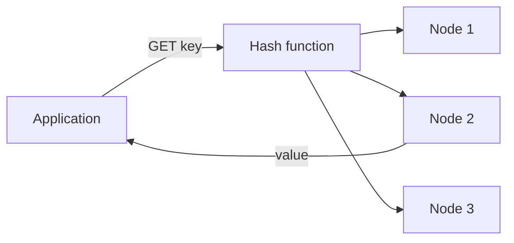

---
tags:
  - databases
  - nosql
  - key-value-store
  - exam-notes
---

# Key-Value Store

## 1. Definition

A **Key-Value store** is the simplest type of **NoSQL database**. It stores data as a collection of **key-value pairs**, where:

- the **key** is a **unique identifier** used to find the data
- the **value** is the **data** stored against that key (a string, number, JSON, list, image, etc.)

> [!important] One-line answer
> A key-value store is a NoSQL database that stores data as **unique key → value pairs** and retrieves a value directly by its key, like a **dictionary** or **hash table**.

```text
Key              Value
-------------    --------------------------------------
user:101         {"name": "Asha", "city": "Pune"}
session:9f3a     "logged_in"
cart:101         ["phone", "charger", "earbuds"]
page_views       15872
```

---

## 2. Key Characteristics

| Feature | Description |
|---|---|
| **Unique key** | Each key appears only once and identifies exactly one value |
| **Opaque value** | The database usually does not interpret or index the inside of the value |
| **Schema-less** | No fixed tables, rows, or columns; values can have any structure |
| **Direct access** | Data is fetched by key, not by complex queries or joins |
| **Hash-based lookup** | Keys are hashed to locate data quickly, giving close to **O(1)** access |
| **Simple API** | Only a few basic operations |

---

## 3. Basic Operations

| Operation | Purpose | Example (Redis style) |
|---|---|---|
| **PUT / SET** | Store or update a value for a key | `SET user:101 "Asha"` |
| **GET** | Retrieve the value of a key | `GET user:101` |
| **DELETE** | Remove a key and its value | `DEL user:101` |
| **EXISTS** | Check whether a key exists | `EXISTS user:101` |

```python
# A Python dictionary behaves like a key-value store
store = {}

store["user:101"] = "Asha"      # PUT
print(store["user:101"])        # GET  -> Asha
del store["user:101"]           # DELETE
```

---

## 4. How It Works

1. The application sends a **key** (and a value for writes).
2. The store applies a **hash function** to the key.
3. The hash decides **which node/partition and memory location** holds the data.
4. The value is read or written **directly**, with no table scans or joins.



---

## 5. Benefits (Advantages)

| Benefit | Explanation |
|---|---|
| **Simplicity** | Very simple data model and API (put, get, delete); easy to learn and use |
| **High speed / low latency** | Direct lookup by key, often in memory, gives very fast reads and writes |
| **Scalability** | Easy to scale **horizontally** by adding servers, since data is partitioned (**sharded**) by key |
| **High performance under load** | Handles millions of simple requests per second |
| **Flexibility (schema-less)** | Values can be strings, JSON, lists, or binary; structure can change without migrations |
| **High availability** | Data is **replicated** across nodes, so the system survives server failures |
| **Efficient caching** | Ideal as a cache in front of a slower database, reducing load and response time |
| **Lower cost** | Runs on commodity hardware; no complex joins or query optimizers |
| **Easy partitioning** | A key naturally decides where data lives |
| **Good fit for big data** | Works well for large volumes of simple, independent records |

---

## 6. Limitations

- **No complex queries:** no joins, and limited searching by anything other than the key.
- **No relationships:** hard to model relations between entities.
- **Limited querying inside values:** the value is mostly treated as opaque.
- **Weaker consistency in some systems:** many offer **eventual consistency** (see [[CAP-Theorem-vs-ACID]]).
- **Weaker transaction support:** multi-key transactions are limited in many stores.
- **Key design matters:** poor key naming makes data hard to organize and retrieve.

---

## 7. Common Use Cases

- **Caching:** web pages, database query results (Redis, Memcached)
- **Session management:** login sessions, authentication tokens
- **Shopping carts:** store each user's cart under their ID
- **User profiles and preferences**
- **Real-time leaderboards and counters:** page views, likes
- **Configuration and feature flags:** (etcd, Consul)
- **Message queues and rate limiting**
- **IoT and gaming:** fast storage of device or player state

---

## 8. Popular Key-Value Stores

| Store | Notes |
|---|---|
| **Redis** | In-memory, very fast, also supports lists, sets, hashes |
| **Memcached** | Simple in-memory cache |
| **Amazon DynamoDB** | Managed, highly scalable, key-value and document |
| **Riak** | Distributed, highly available |
| **etcd** | Distributed store for configuration data |
| **Berkeley DB** | Embedded key-value database |

---

## 9. Key-Value Store vs Relational Database

| Basis | Key-Value Store | Relational Database (RDBMS) |
|---|---|---|
| **Data model** | Key → value pairs | Tables with rows and columns |
| **Schema** | Schema-less, flexible | Fixed schema |
| **Query language** | Simple get/put/delete | SQL with joins and aggregations |
| **Relationships** | Not supported directly | Supported through foreign keys |
| **Speed for simple lookups** | Very fast | Slower |
| **Scalability** | Easy horizontal scaling | Mainly vertical scaling, harder to shard |
| **Consistency model** | Often eventual (BASE) | Strong (ACID) |
| **Best for** | Caching, sessions, simple lookups | Complex queries, transactions, reporting |

---

## 10. Example Scenario

An e-commerce site stores each shopping cart as:

```text
Key:   cart:user101
Value: {"items": ["phone", "charger"], "total": 21500}
```

When user 101 opens the cart page, the app does a single `GET cart:user101` and receives the whole cart instantly, with no joins across product, user, and order tables.

---

## 11. Sample 5-Mark Answer

> A **key-value store** is a type of NoSQL database that stores data as **unique key-value pairs**. The key identifies the data and the value holds the data itself, which can be a string, number, JSON, or binary object. Data is accessed directly by key using simple operations such as **put, get, and delete**, in a way similar to a hash table or dictionary. Examples include **Redis, DynamoDB, and Riak**.
>
> **Benefits:** it is **simple**, gives **very fast read/write** access, is **highly scalable** because data can be partitioned across many servers by key, is **schema-less and flexible**, provides **high availability** through replication, and is ideal for **caching, session storage, and shopping carts**.

---

## 12. Quick Revision Points

1. Key-value store = **unique key → value**, a NoSQL type.
2. Works like a **hash table / dictionary**.
3. Operations: **PUT, GET, DELETE**.
4. Benefits: **simple, fast, scalable, flexible, highly available**.
5. Limitations: **no joins, limited queries, weaker transactions**.
6. Uses: **caching, sessions, carts, counters**.
7. Examples: **Redis, DynamoDB, Riak, Memcached**.

---

## 13. Likely Exam Questions

1. Define a key-value store and explain its benefits.
2. How does a key-value store work?
3. List the advantages and limitations of key-value stores.
4. Differentiate between a key-value store and an RDBMS.
5. Give use cases and examples of key-value databases.
6. Why are key-value stores highly scalable?
7. 