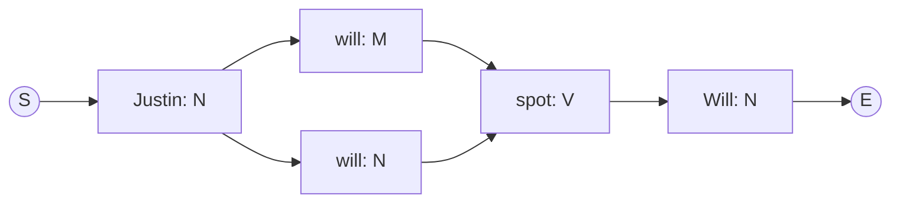

![[Pasted image 20261109195414.png]]So the first algo is:
![[Pasted image 20261109195436.png]]![[Pasted image 20261109195447.png]]but this doesnt work all the time cuz word have different meaning accordgin to the context

![[Pasted image 20261109195535.png]]
to solve this we can make a bigram trigram and compared all of them to find the context
![[Pasted image 20261109195620.png]]but there is one more problem:
![[Pasted image 20261109195813.png]]Your table stores word pairs such as `jane-can`, `can-see`, and `will-see`, along with their possible tag pairs. But the test sentence contains `Jane will`, which does not appear as a pair in the training sentences shown. So a direct lookup has no evidence for that pair.[image.jpg](https://ppl-ai-file-upload.s3.amazonaws.com/web/direct-files/attachments/images/50124771/70594132-3d21-46be-866e-829c190907f9/image.jpg)

This is called **sparsity**: many valid combinations are missing from limited training data. Using longer word sequences—trigrams, four-grams, etc.—makes exact matches even harder to find.[aclanthology](https://aclanthology.org/N09-2054.pdf)

## 2. How does an HMM help?

Instead of requiring the exact word pair, it combines two reusable probabilities:

- Transition: P(next tag∣previous tag)P(\text{next tag}\mid\text{previous tag})P(next tag∣previous tag), such as how likely `N → M` is.
    
- Emission: P(word∣tag)P(\text{word}\mid\text{tag})P(word∣tag), such as how likely the tag `M` is to produce “will.”[web.stanford](https://web.stanford.edu/~jurafsky/slp3/old_dec21/8.pdf)
    

So even without seeing `Jane will` together, it can combine evidence that Jane occurs as a noun, “will” occurs as a modal, and nouns can be followed by modals
![[Pasted image 20261109195906.png]]![[Pasted image 20261109195930.png]]![[Pasted image 20261109195942.png]]![[Pasted image 20261109200010.png]]![[Pasted image 20261109200023.png]]![[Pasted image 20261109200035.png]]
# Limitations

The main limitation of an HMM POS tagger is that it makes strong simplifying assumptions: a tag depends mostly on a very small local context, and a word depends only on its own tag. This makes HMMs fast and easy to train, but weak for long-distance syntax, unknown words, and rich contextual features.

## Main limitations

### 1. Limited context

A basic HMM uses the **Markov assumption**: the current tag depends only on the previous tag.

```
P(t_i \mid t_1,\ldots,t_{i-1}) \approx P(t_i \mid t_{i-1})
```

A trigram HMM uses the previous two tags, but it still cannot capture dependencies spread across a long sentence

Example:

> “The keys to the cabinet on the table **are** missing.”

Here, _keys_ and _are_ are grammatically connected even though many words separate them. A bigram HMM may fail because it only looks at the immediately preceding tag.

### 2. Strong independence assumptions

HMM assumes that each word is emitted independently based only on its own POS tag:

```
P(w_i \mid t_i)
```

It does not naturally model interactions between words, such as subject-verb agreement, semantic meaning, or phrase structure.[[cl.cam.ac](https://www.cl.cam.ac.uk/teaching/1516/L101/clark_lecs/notes_2.pdf)][[scribd](https://www.scribd.com/document/933301741/finalnlp)]

Example:

> “The dogs bark.”

The plural noun _dogs_ and plural verb _bark_ are related, but a basic HMM treats each word’s emission separately. It may not fully use this agreement information.

### 3. Unknown-word problem

If a word was not seen during training, the HMM has no emission probability for it:

```
P(\text{new word} \mid \text{tag}) = 0
```

This can incorrectly force the probability of an entire tag sequence to zero. HMM taggers therefore require smoothing and special handling for unknown words.[[cl.cam.ac](https://www.cl.cam.ac.uk/teaching/1617//L101/slides2.pdf)][[uima.apache](https://uima.apache.org/downloads/sandbox/hmmTaggerUsersGuide/hmmTaggerUsersGuide.html)]

Example:

> “The startup is developing quantumcrypto tools.”

If _quantumcrypto_ never appeared in training data, the model has no direct probability for it. It may assign the wrong tag or fail to tag it properly.

### 4. Data sparsity

HMMs need a large annotated corpus to estimate transition and emission probabilities reliably. Rare tag transitions, rare word-tag pairs, and unseen tag sequences may have zero or unreliable counts.[[cl.cam.ac](https://www.cl.cam.ac.uk/teaching/1516/L101/clark_lecs/notes_2.pdf)][[cl.cam.ac](https://www.cl.cam.ac.uk/teaching/1617//L101/slides2.pdf)]

Example:

> “The CEO announced the acquisition.”

If the training data rarely contains the transition:

```
\text{PROPER NOUN} \rightarrow \text{VERB}
```

then the HMM may mislabel _announced_. Smoothing helps, but it cannot fully solve the sparsity problem.

### 5. Difficulty with ambiguity

POS ambiguity is still difficult because the same word can have multiple possible tags. The HMM chooses based mainly on nearby tags and emission counts, not deeper sentence meaning.[[scribd](https://www.scribd.com/document/933301741/finalnlp)][[link.springer](https://link.springer.com/article/10.1186/s40537-022-00561-y?error=cookies_not_supported&code=75dfb8c3-5d50-4a3c-a52b-01823a3919e7)]

Example:

|Sentence|Word|Correct tag|
|---|---|---|
|“I read a **book**.”|book|Noun|
|“Please **book** a ticket.”|book|Verb|
|“I saw a **bear**.”|bear|Noun|
|“I can’t **bear** this.”|bear|Verb|

A simple HMM may choose the wrong tag when the surrounding context is unusual or insufficient.

### 6. Weak feature representation

HMMs are generative models, so adding rich overlapping features—such as word suffixes, capitalization, previous words, semantic information, or dependency information—is difficult and can make probability estimation complicated. Discriminative models such as CRFs handle such features more naturally.[[cl.cam.ac](https://www.cl.cam.ac.uk/teaching/1516/L101/clark_lecs/notes_2.pdf)][[cl.cam.ac](https://www.cl.cam.ac.uk/teaching/1617//L101/slides2.pdf)]

Example:

- A word ending in **-ing** is often a verb form, but it can also be a noun or adjective.
- A capitalized word is often a proper noun, but not always.
- A word after _the_ is often a noun, but context can change this.

An HMM cannot easily combine all these clues in a flexible way.

### 7. Domain dependence

A model trained on one type of text may perform poorly on another domain because vocabulary, writing style, and tag distributions change. Accuracy typically decreases when the test corpus differs from the training corpus, mainly because of more unknown words.[[uima.apache](https://uima.apache.org/downloads/sandbox/hmmTaggerUsersGuide/hmmTaggerUsersGuide.html)]

Example:

- A tagger trained on news articles may struggle with tweets.
- It may fail on code-mixed Hindi-English text.
- It may mislabel medical or legal terms not seen during training.

Example:

> “Bhai, this reel is fire 🔥.”

Informal words, slang, emojis, and mixed-language text may be absent from a formal training corpus.

### 8. Fixed tag set

The HMM can output only the tags present in its training data. If a new annotation scheme or language uses tags not seen during training, the model cannot produce them.

Example:

- Training data uses `NN` for nouns.
- A new dataset uses `PROPN` for proper nouns.
- The HMM cannot output `PROPN` unless it is retrained or the tag set is changed.

### 9. Lower accuracy on rare tags

Frequent tags such as nouns, verbs, determiners, and prepositions have many examples, while rare tags may have very few. This class imbalance causes lower accuracy for less frequent POS categories.[[link.springer](https://link.springer.com/article/10.1186/s40537-022-00561-y?error=cookies_not_supported&code=75dfb8c3-5d50-4a3c-a52b-01823a3919e7)]

Example:

- Interjections such as _wow_, _oops_, and _hmm_ may occur rarely.
- Rare verb forms or unusual grammatical constructions may be poorly learned.

### 10. Less powerful than modern models

HMMs are still useful because they are fast, simple, and can be trained efficiently by counting probabilities. However, modern sequence models such as CRFs, RNNs, and transformer-based models can use richer context and features, so they generally perform better on complex language tasks.

# Problem 

---
title: HMM POS Tagging - Justin will spot Will
tags: [nlp, hmm, pos-tagging, viterbi]
---

# HMM POS Tagging: *Justin will spot Will*

## Given corpus

| Sentence | POS sequence |
|---|---|
| S Martin Justin can watch Will E | S → N → N → M → V → N → E |
| S Spot will watch Martin E | S → N → M → V → N → E |
| S Will Justin spot Martin E | S → N → N → V → N → E |
| S Martin will pat Spot E | S → N → M → V → N → E |

**Tags**

- **N** (Noun): Martin, Justin, Will, Spot
- **M** (Modal): can, will
- **V** (Verb): watch, spot, pat

**Tag this sentence:** `Justin will spot Will`

> [!note] Case
> Words are treated case-insensitively, so `Will` and `will` are the same word type, and `Spot` and `spot` are the same word type.

---

## Step 1: Count transitions

| From → To | Count |
|---|---:|
| S → N | 4 |
| N → N | 2 |
| N → M | 3 |
| N → V | 1 |
| N → E | 4 |
| M → V | 3 |
| V → N | 4 |
| V → M | 0 |

Totals out of each tag:

- From S: $4$
- From N: $2 + 3 + 1 + 4 = 10$
- From M: $3$
- From V: $4$

---

## Step 2: Transition probability matrix

$$
P(t_i \mid t_{i-1}) = \frac{C(t_{i-1}, t_i)}{C(t_{i-1})}
$$

| From \ To | N | M | V | E |
|---|---:|---:|---:|---:|
| **S** | 1 | 0 | 0 | 0 |
| **N** | 0.2 | 0.3 | 0.1 | 0.4 |
| **M** | 0 | 0 | 1 | 0 |
| **V** | 1 | 0 | 0 | 0 |

---

## Step 3: Count emissions

| Tag | Word | Count |
|---|---|---:|
| N | Martin | 4 |
| N | Justin | 2 |
| N | Will | 2 |
| N | Spot | 2 |
| M | can | 1 |
| M | will | 2 |
| V | watch | 2 |
| V | spot | 1 |
| V | pat | 1 |

Totals: **N = 10**, **M = 3**, **V = 4**

---

## Step 4: Emission probability matrix

$$
P(w_i \mid t_i) = \frac{C(t_i, w_i)}{C(t_i)}
$$

| Tag \ Word | Martin | Justin | Will | Spot | can | will | watch | spot | pat |
|---|---:|---:|---:|---:|---:|---:|---:|---:|---:|
| **N** | 0.4 | 0.2 | 0.2 | 0.2 | 0 | 0 | 0 | 0 | 0 |
| **M** | 0 | 0 | 0 | 0 | 1/3 | 2/3 | 0 | 0 | 0 |
| **V** | 0 | 0 | 0 | 0 | 0 | 0 | 0.5 | 0.25 | 0.25 |

(Merging case: *Will/will* is N with probability 0.2 and M with probability 2/3. *Spot/spot* is N with probability 0.2 and V with probability 0.25.)

---

## Step 5: Possible tag sequences

| Word | Possible tags |
|---|---|
| Justin | N |
| will | M, N |
| spot | V |
| Will | N, M |

Candidates:

1. N M V N
2. N M V M ❌ (since $P(M \mid V) = 0$)
3. N N V N
4. N N V M ❌ (since $P(M \mid V) = 0$)

Two valid sequences remain.

---

## Step 6: Score with the HMM

$$
P(\text{tags}, \text{words}) = P(t_1 \mid S)\,P(w_1 \mid t_1) \prod_{i=2}^{n} P(t_i \mid t_{i-1})\,P(w_i \mid t_i) \cdot P(E \mid t_n)
$$

### Sequence 1: Justin/N will/M spot/V Will/N

$$
P = P(N\mid S)\,P(\text{Justin}\mid N)\,P(M\mid N)\,P(\text{will}\mid M)\,P(V\mid M)\,P(\text{spot}\mid V)\,P(N\mid V)\,P(\text{Will}\mid N)\,P(E\mid N)
$$

$$
P = 1 \times 0.2 \times 0.3 \times \tfrac{2}{3} \times 1 \times 0.25 \times 1 \times 0.2 \times 0.4 = 0.0008
$$

### Sequence 2: Justin/N will/N spot/V Will/N

$$
P = P(N\mid S)\,P(\text{Justin}\mid N)\,P(N\mid N)\,P(\text{will}\mid N)\,P(V\mid N)\,P(\text{spot}\mid V)\,P(N\mid V)\,P(\text{Will}\mid N)\,P(E\mid N)
$$

$$
P = 1 \times 0.2 \times 0.2 \times 0.2 \times 0.1 \times 0.25 \times 1 \times 0.2 \times 0.4 = 0.000016
$$

---

## Step 7: Pick the best sequence

| Tag sequence | Probability |
|---|---:|
| **N M V N** | **0.0008** |
| N N V N | 0.000016 |
| N M V M | 0 |
| N N V M | 0 |

$$
0.0008 > 0.000016
$$

## Final answer

$$
\boxed{\text{Justin/N} \;\; \text{will/M} \;\; \text{spot/V} \;\; \text{Will/N}}
$$

> [!success] Result
> **Justin/N will/M spot/V Will/N**
> The HMM prefers *will* as a modal because $P(M \mid N) = 0.3$ and $P(\text{will} \mid M) = \tfrac{2}{3}$ beat the noun reading ($P(N \mid N) = 0.2$, $P(\text{will} \mid N) = 0.2$).

---

## Viterbi view (optional)



Best path: **S → N → M → V → N → E** (probability 0.0008).
