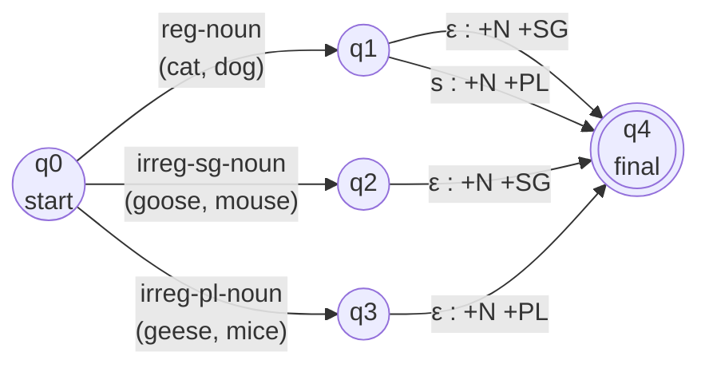
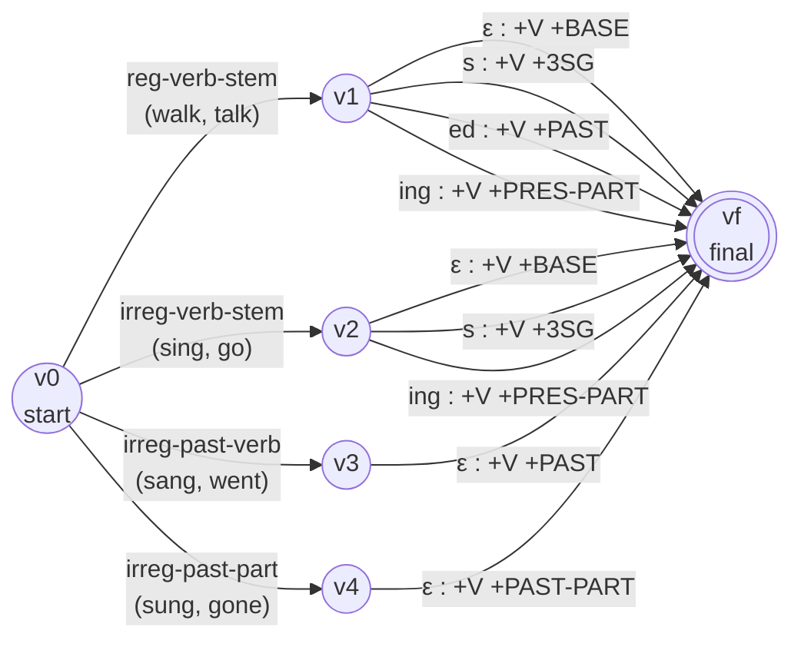
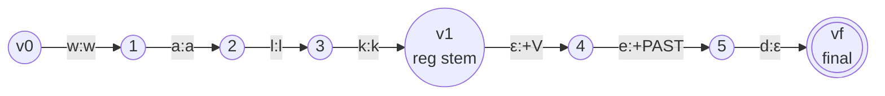
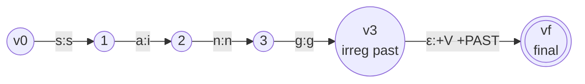
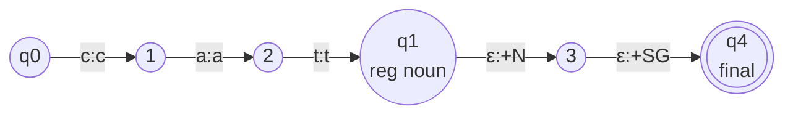
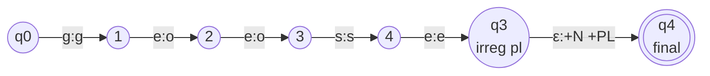

---
title: Morphological Analysis Output
subject: Natural Language Processing
semester: 7
tags: [NLP, morphology, FSA, FST, MU, BTech-CS, SEM7]
---

# Output of Morphological Analysis

Covers: **Regular verb, Irregular verb, Singular noun, Plural noun**

> Morphological analysis takes a **surface word** and gives its **stem + features**.
> It is done by an FST (input tape = surface form, output tape = lexical form).
> There is **one unified machine for nouns** and **one unified machine for verbs**. Regular and irregular forms are just different branches of the same machine.

---

## 1. Output Table

| Category | Input (surface) | Output (stem + features) |
|---|---|---|
| Singular noun (regular) | cat | `cat +N +SG` |
| Singular noun (irregular) | goose | `goose +N +SG` |
| Plural noun (regular) | cats | `cat +N +PL` |
| Plural noun (irregular) | geese | `goose +N +PL` |
| Regular verb (base) | walk | `walk +V +BASE` |
| Regular verb (3rd person) | walks | `walk +V +3SG` |
| Regular verb (past) | walked | `walk +V +PAST` |
| Regular verb (-ing) | walking | `walk +V +PRES-PART` |
| Irregular verb (base) | sing | `sing +V +BASE` |
| Irregular verb (past) | sang | `sing +V +PAST` |
| Irregular verb (past participle) | sung | `sing +V +PAST-PART` |
| Irregular verb (-ing) | singing | `sing +V +PRES-PART` |

**Tags:** `+N` noun, `+V` verb, `+SG` singular, `+PL` plural, `+3SG` 3rd person singular, `+PAST` past tense, `+PAST-PART` past participle, `+PRES-PART` present participle, `ε` empty string.

---

## 2. Unified Noun Machine (singular + plural, regular + irregular)

| State | Meaning |
|---|---|
| q0 | Start |
| q1 | Regular noun stem read |
| q2 | Irregular singular noun read |
| q3 | Irregular plural noun read |
| q4 | Final (accept) |

**Outputs from this machine**

| Path | Example | Output |
|---|---|---|
| q0 → q1 → q4 (ε) | cat | `cat +N +SG` |
| q0 → q1 → q4 (s) | cats | `cat +N +PL` |
| q0 → q2 → q4 | goose | `goose +N +SG` |
| q0 → q3 → q4 | geese | `goose +N +PL` |

---

## 3. Unified Verb Machine (regular + irregular)

| State | Meaning |
|---|---|
| v0 | Start |
| v1 | Regular verb stem read (takes -s, -ed, -ing) |
| v2 | Irregular verb stem read (takes -s, -ing, **not** -ed) |
| v3 | Irregular past form read (sang) |
| v4 | Irregular past participle read (sung) |
| vf | Final (accept) |

**Key difference:** a regular verb forms past with `-ed`. An irregular verb has its past and past participle **stored as separate words** in the lexicon, so it reaches the final state through v3 or v4 instead of `-ed`.

**Outputs from this machine**

| Path | Example | Output |
|---|---|---|
| v0 → v1 → vf (ε) | walk | `walk +V +BASE` |
| v0 → v1 → vf (s) | walks | `walk +V +3SG` |
| v0 → v1 → vf (ed) | walked | `walk +V +PAST` |
| v0 → v1 → vf (ing) | walking | `walk +V +PRES-PART` |
| v0 → v2 → vf (ε) | sing | `sing +V +BASE` |
| v0 → v2 → vf (ing) | singing | `sing +V +PRES-PART` |
| v0 → v3 → vf | sang | `sing +V +PAST` |
| v0 → v4 → vf | sung | `sing +V +PAST-PART` |

---

## 4. Step-by-Step State Transitions (one example each)

### Regular verb: walked → walk +V +PAST

### Irregular verb: sang → sing +V +PAST

### Singular noun: cat → cat +N +SG

### Plural noun: geese → goose +N +PL

---

## 5. Quick Revision Points

- Output = **stem + morphological features**.
- **One FSA for nouns, one for verbs.** Regular and irregular are branches of the same machine, selected by the lexicon class.
- Regular noun: stem + `s` gives `+PL`, stem alone gives `+SG`.
- Irregular noun: whole form stored (`geese`, `mice`), mapped to stem + `+PL`.
- Regular verb: stem + `s` / `ed` / `ing`.
- Irregular verb: stored past (`sang`) and participle (`sung`) forms, no `-ed`.
- FST transition format is `input:output`, and `ε` means empty.
- 