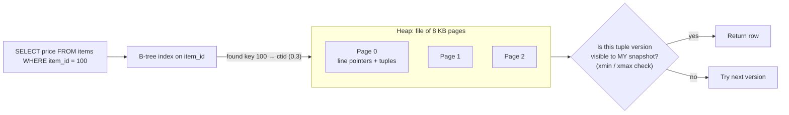
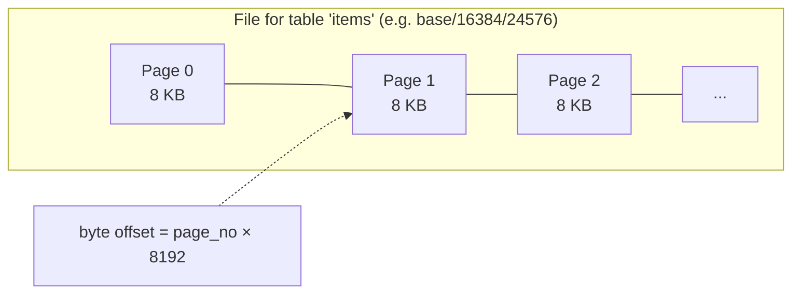
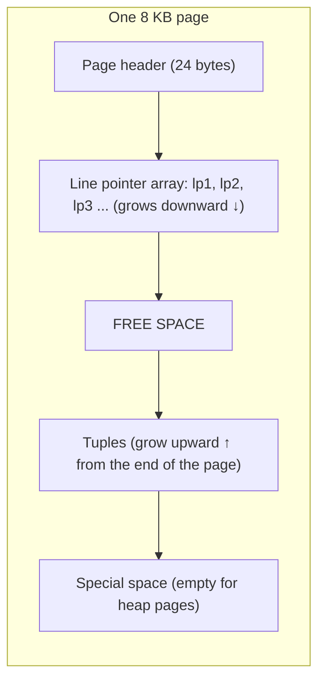
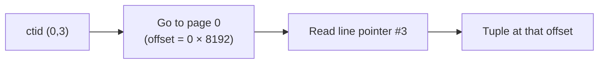
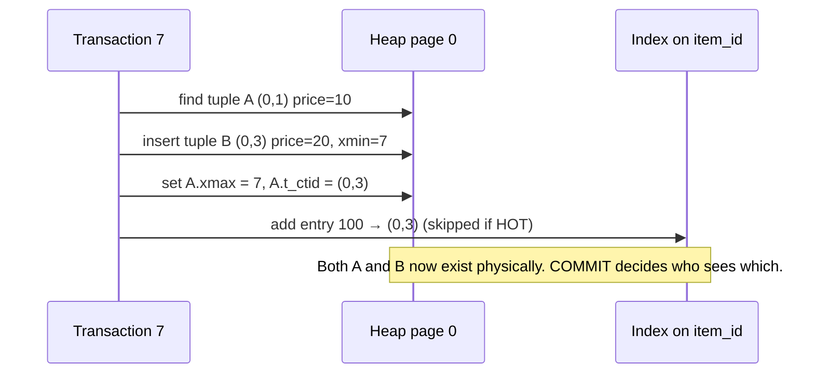
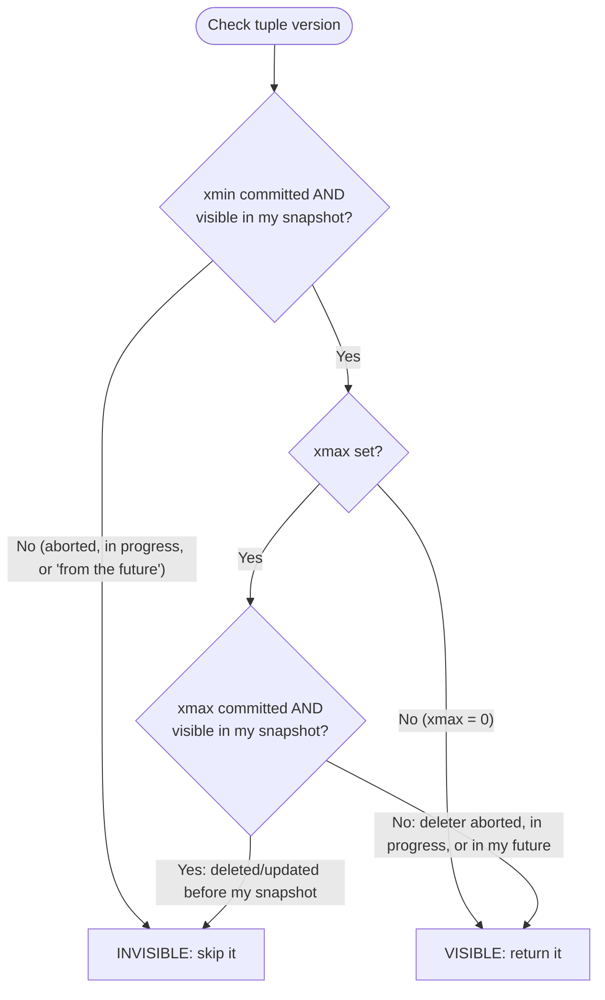
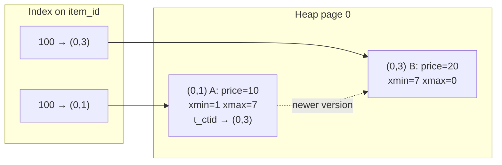
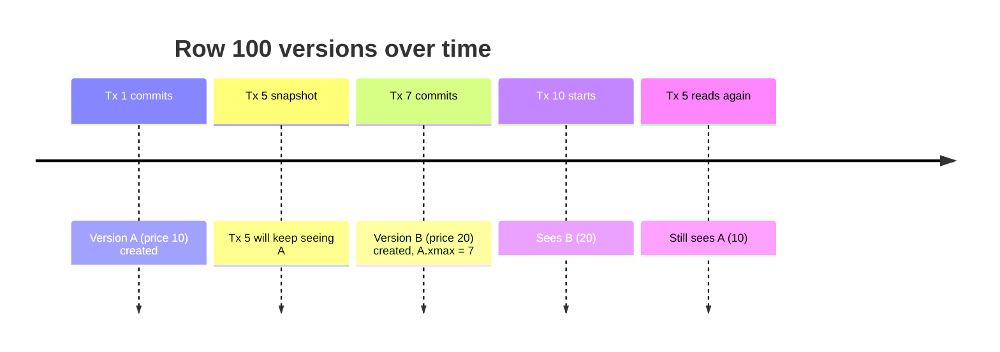
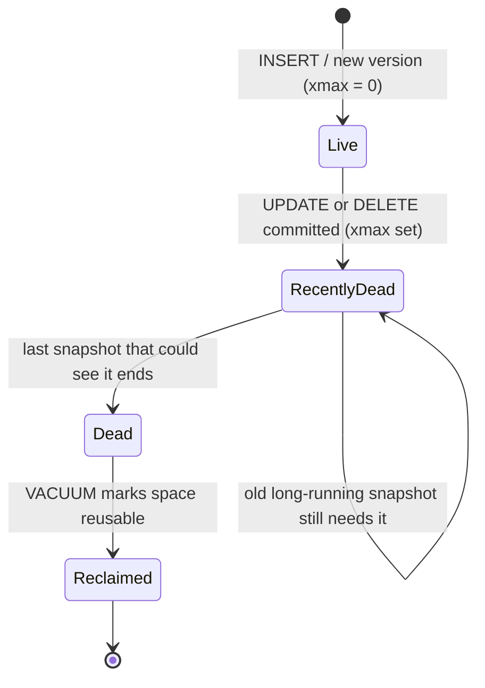
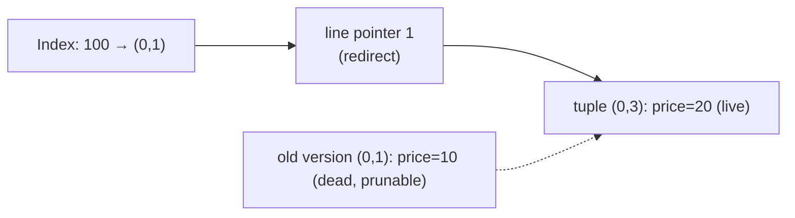

## Table of Contents

- [[#1. Big picture in one diagram]]
- [[#2. Table file, pages, heap]]
- [[#3. Tuples and line pointers]]
- [[#4. ctid: the tuple address]]
- [[#5. Indexes point to ctid]]
- [[#6. UPDATE never edits in place]]
- [[#7. MVCC: xmin, xmax, snapshots, visibility]]
- [[#8. Worked example: three transactions, one row]]
- [[#9. Dead tuples, VACUUM, bloat, snapshot pinning]]
- [[#10. HOT updates]]
- [[#11. Hands-on labs]]
- [[#12. Cheat sheet and self-check]]


---
## 1. Big picture in one diagram



Three layers to remember:

|Layer|Question it answers|
|---|---|
|**Index (B-tree)**|_Where_ might the row be? (gives `ctid`s)|
|**Heap (pages and tuples)**|_What_ are the row versions?|
|**MVCC (xmin/xmax + snapshot)**|_Which_ version may this transaction see?|

---

## 2. Table file, pages, heap

- Each table lives in its **own file(s)** on disk. Find it: `SELECT pg_relation_filepath('items');`
- The file is just an **array of fixed-size pages**: page 0, page 1, page 2, ...
- Default page size is **8 KB** (fixed at compile time; check with `SHOW block_size;`).
- Pages are allocated **only when needed** (empty table = empty file).
- Because pages are fixed-size and numbered, Postgres can jump straight to byte offset `page_number × 8192`. No searching.
- Postgres reads and writes **whole pages**, never single rows. A page gets pulled into **`shared_buffers`** (memory) first.

> [!note] What is "the heap"? The **heap** is the table's main storage: all pages holding the actual row data, unordered. It exists on disk and (partly) in `shared_buffers`. "Heap" here does **not** mean the memory heap or the priority-queue data structure. It just means "unordered pile of rows".



### Inside one page



The two ends grow toward each other; the page is full when they meet.

---

## 3. Tuples and line pointers

A **tuple** is a **row version** (not "the row"). One logical row can have several physical tuples at once (that _is_ MVCC).

Each tuple = **tuple header + column data**.

Important header fields:

|Field|Meaning|
|---|---|
|`xmin`|XID of the transaction that **created** this version|
|`xmax`|XID of the transaction that **deleted or updated** it (0 = still live). Also reused for row locks|
|`ctid` (`t_ctid`)|Own address, or pointer to the **newer version** if this one was updated|
|infomask bits|Hint bits: "xmin committed", "xmax aborted", ... (speed up visibility checks)|

- XIDs are **32-bit** numbers (hence XID wraparound is a real operational topic; autovacuum "freezes" old tuples).
- **Line pointer** (a.k.a. item ID) = a small slot in the page header area that stores the **offset + length** of the tuple inside the page. It is an extra level of indirection, which is why tuples can be moved inside a page without changing their address.
- Big values (long text, big JSONB) are moved out of line into a **TOAST table**; the tuple keeps a small pointer. The video simplifies this away.

---

## 4. ctid: the tuple address

`ctid = (page number, line pointer number)`

```
ctid = (0,3)   →  page 0, line pointer 3
```

```sql
SELECT ctid, xmin, xmax, * FROM items;
```



> [!quote] Fantastic design AND miserable design **Fantastic:** `ctid` is a _physical_ address. Given a ctid, Postgres goes to exactly one 8 KB page and one slot: a single page read even if the table is 7 GB. **Miserable:** because it is physical, **every index entry stores a ctid**, so when a row gets a new physical location (an UPDATE), the indexes must learn about it. That is the root of Postgres' **write amplification** and the 2016 Uber post (see [[Postgres Stack Notes#4.7 How updates work internally (the famous write-amplification debate)]]).

> [!warning] ctid is not a stable ID A row's ctid **changes** on every UPDATE and after `VACUUM FULL`. Never store it as a key. Use a primary key.

---

## 5. Indexes point to ctid

Conceptually an index is a **key → ctid** lookup (physically a B+tree: sorted leaf pages chained together).

|Index entry (key)|→ ctid|
|---|---|
|100|(0,1)|
|200|(0,2)|
|700|(1,5)|

Consequences:

1. A lookup on `item_id` finds a **ctid**, then goes to the heap page.
2. If the query needs a column **not in the index** (like `price`), the heap visit is mandatory anyway.
3. The heap visit is **also** needed to run the **visibility check** (xmin/xmax live in the heap tuple header, not in the index). That is why a plain index scan always touches the heap.
4. **Index-only scans** can skip the heap only when all needed columns are in the index **and** the **visibility map** says the page is all-visible (maintained by VACUUM).

> [!tip] Contrast Postgres: secondary indexes store **physical ctid**. MySQL/InnoDB: secondary indexes store the **primary key value**, so a row move inside the clustered index doesn't touch them, but lookups need a second hop.

---

## 6. UPDATE never edits in place

```sql
UPDATE items SET price = 20 WHERE item_id = 100;
```

What Postgres actually does:

1. Finds the current tuple version (A) at `(0,1)`.
2. Writes a **brand-new tuple** (B) with `price = 20`, preferably **on the same page** if there's free space.
3. Stamps A: `xmax = <this transaction>`; sets A's `t_ctid` → B's address.
4. Stamps B: `xmin = <this transaction>`, `xmax = 0`.
5. Updates **indexes**: a new entry for B _unless_ it's a HOT update ([[#10. HOT updates]]).



`DELETE` is the same idea minus the new tuple: it only sets `xmax`. `ROLLBACK` is instant: the new tuple's creator aborted, so it is simply ignored (and cleaned later).

---

## 7. MVCC: xmin, xmax, snapshots, visibility

**MVCC = Multi-Version Concurrency Control.** Instead of locking rows so readers wait for writers, Postgres keeps **old versions** around and lets every transaction read the version that was current **for its snapshot**.

- Readers never block writers; writers never block readers.
- Writers still block **other writers on the same row**.
- Cost: dead versions pile up until VACUUM removes them.

### What is a snapshot?

A snapshot is a small record taken at a point in time saying roughly:

- "every transaction with ID **below X** is finished (committed or aborted)"
- "transactions **at/above Y** haven't started yet: invisible to me"
- "this list of **in-progress** XIDs: also invisible to me"

|Isolation level|When the snapshot is taken|
|---|---|
|Read Committed (default)|At the start of **each statement**|
|Repeatable Read|Once, at the **first statement** of the transaction|
|Serializable|Like Repeatable Read + conflict detection (retry on failure)|

### The visibility rule (simplified)

A tuple version is **visible** to my snapshot if:

1. its **creator (`xmin`) committed and is visible** to my snapshot (or it's my own transaction's change), **and**
2. its **deleter (`xmax`) is 0, aborted, still in progress, or not visible** to my snapshot.



> [!note] Where does "committed?" come from? Postgres checks the commit log (**pg_xact**, formerly clog) and then caches the answer as **hint bits** in the tuple header so later readers skip the lookup. (This is why even a `SELECT` can dirty a page.)

---

## 8. Worked example: three transactions, one row

Setup: table `items(item_id, price)`, index on `item_id`.

|Step|Who|Action|Heap result|
|---|---|---|---|
|1|Tx 1|`INSERT (100, 10)`, commit|**A** `(0,1)`: price 10, `xmin=1, xmax=0`|
|2|Tx 2|`INSERT (200, 5)`, commit|`(0,2)`: price 5, `xmin=2, xmax=0`|
|3|Tx 5|`BEGIN ISOLATION LEVEL REPEATABLE READ;` + first query (snapshot taken, still open)|unchanged|
|4|Tx 7|`UPDATE price = 20 WHERE item_id = 100`, commit|**A** `(0,1)`: `xmax=7`, `t_ctid → (0,3)`; **B** `(0,3)`: price 20, `xmin=7, xmax=0`|
|5|Tx 10|`SELECT price WHERE item_id = 100`|see below|
|6|Tx 5|same `SELECT` again|see below|



**Step 5, Tx 10** (snapshot taken after Tx 7 committed): index returns **both** ctids, so the heap is visited.

- A: `xmin=1` visible, but `xmax=7` committed and visible → **deleted for me → skip**.
- B: `xmin=7` committed and visible, `xmax=0` → **visible → returns 20**.

**Step 6, Tx 5** (Repeatable Read, snapshot taken _before_ Tx 7 committed): same two ctids.

- A: `xmin=1` visible; `xmax=7` is **in my future** → the delete doesn't exist for me → **visible → returns 10**.
- B: `xmin=7` is in my future → **invisible → skip**.

Same row, same moment, two correct answers. That's snapshot isolation.



---

## 9. Dead tuples, VACUUM, bloat, snapshot pinning

A tuple version is **dead** only when **no current or future snapshot can possibly see it**, i.e. its `xmax` is committed and older than the **oldest snapshot still in use** (the "xmin horizon").



- **VACUUM / autovacuum** scans for dead tuples, marks their space reusable, updates the **free space map** and **visibility map**, and cleans index entries that point at them. It doesn't normally shrink the file (`VACUUM FULL` does, but takes a heavy lock).
- **Snapshot pinning:** a long-running transaction (the "ancient transaction" in the video) holds its snapshot open, so every old version it might still need is **pinned**. VACUUM _can't_ remove them → **bloat**: bigger tables and indexes, slower scans, more cache misses.
- Other things that hold the horizon back: idle-in-transaction sessions, abandoned replication slots, lagging replicas with `hot_standby_feedback`, prepared transactions.

> [!tip] Operational rules that fall out of this
> 
> - Keep transactions **short**. Never leave a session `idle in transaction`.
> - Set `idle_in_transaction_session_timeout` and `statement_timeout`.
> - Monitor oldest `backend_xmin` and dead tuples (queries in [[#11. Hands-on labs]]).
> - Update-heavy tables: lower `autovacuum_vacuum_scale_factor` per table, and consider `fillfactor < 100` to enable HOT.

---

## 10. HOT updates

**HOT = Heap-Only Tuple.** If an UPDATE

1. changes **no indexed column**, and
2. the new version fits **on the same page**,

then Postgres links old → new inside the page (via `t_ctid`) and **does not add any index entries**. The index still points at the _original_ line pointer, which redirects to the newest version.



||Normal update|HOT update|
|---|---|---|
|New heap tuple|yes|yes|
|New index entries (every index)|**yes**|**no**|
|Needs free space on same page|not required|**required**|
|Old versions cleaned by|VACUUM|page-level **pruning** (cheap, even during normal reads)|

For the video's example (`price` isn't indexed) the update is HOT as long as page 0 has room. Check with `n_tup_hot_upd`.

> [!tip] Why "fewer indexes = faster writes" Every extra index on a frequently updated column kills HOT eligibility and adds one more B-tree insert per update. This ties directly to [[Postgres Stack Notes#2.4 Indexes]].

---

## 11. Hands-on labs

> [!example] Lab A: See pages, line pointers and tuple headers
> 
> ```sql
> CREATE EXTENSION IF NOT EXISTS pageinspect;
> SHOW block_size;                          -- 8192
> 
> CREATE TABLE items (item_id int, price int);
> CREATE INDEX ON items (item_id);
> INSERT INTO items VALUES (100, 10), (200, 5);
> 
> SELECT pg_relation_filepath('items');
> SELECT ctid, xmin, xmax, * FROM items;
> 
> -- Raw page contents: line pointers + tuple headers
> SELECT lp, lp_off, lp_len, t_xmin, t_xmax, t_ctid
> FROM heap_page_items(get_raw_page('items', 0));
> ```
> 
> Then run `UPDATE items SET price = 20 WHERE item_id = 100;` and re-run the `heap_page_items` query. You should see **three** tuples: the old one with `t_xmax` set, and the new one with a new `t_ctid`.

> [!example] Lab B: Snapshot time machine (two psql sessions)
> 
> ```sql
> -- Session 1
> BEGIN ISOLATION LEVEL REPEATABLE READ;
> SELECT price FROM items WHERE item_id = 100;     -- 10 (snapshot taken)
> 
> -- Session 2 (autocommit)
> UPDATE items SET price = 20 WHERE item_id = 100;
> 
> -- Session 1
> SELECT price FROM items WHERE item_id = 100;     -- still 10
> COMMIT;
> SELECT price FROM items WHERE item_id = 100;     -- 20
> ```
> 
> Repeat with `READ COMMITTED`: the second `SELECT` in Session 1 already shows 20. Peek at the versions from Session 2 with `SELECT ctid, xmin, xmax, * FROM items;`.

> [!example] Lab C: Bloat and snapshot pinning
> 
> ```sql
> -- Session 1: hold an old snapshot open
> BEGIN ISOLATION LEVEL REPEATABLE READ;
> SELECT count(*) FROM items;
> 
> -- Session 2: churn the row
> DO $$ BEGIN FOR i IN 1..10000 LOOP
>   UPDATE items SET price = price + 1 WHERE item_id = 100;
> END LOOP; END $$;
> 
> VACUUM VERBOSE items;                 -- reports dead tuples "not yet removable"
> 
> -- Session 1
> COMMIT;
> VACUUM VERBOSE items;                 -- now they can be removed
> ```
> 
> Monitoring queries:
> 
> ```sql
> SELECT relname, n_live_tup, n_dead_tup, last_autovacuum
> FROM pg_stat_user_tables ORDER BY n_dead_tup DESC;
> 
> SELECT pid, state, xact_start, backend_xmin, left(query, 60) AS query
> FROM pg_stat_activity
> WHERE backend_xmin IS NOT NULL
> ORDER BY age(backend_xmin) DESC;     -- the oldest holds back VACUUM
> ```

> [!example] Lab D: HOT vs non-HOT
> 
> 1. Table with an index on `item_id` only. Run 10k updates on `price`; check `SELECT n_tup_upd, n_tup_hot_upd FROM pg_stat_user_tables WHERE relname='items';` (mostly HOT).
> 2. Add `CREATE INDEX ON items (price);` and repeat: HOT count collapses.
> 3. Set `ALTER TABLE items SET (fillfactor = 80);` and compare HOT ratios on a larger table.

---

## 12. Cheat sheet and self-check

|Term|One-liner|
|---|---|
|Page|8 KB block; unit of disk and memory I/O|
|Heap|The table's unordered collection of pages|
|Tuple|One physical **row version**|
|Line pointer|Slot in the page pointing to a tuple (offset + length)|
|`ctid`|`(page, line pointer)`: physical address of a tuple version|
|`xmin` / `xmax`|Creator / deleter transaction IDs|
|Snapshot|Which transactions' effects I can see|
|Dead tuple|Version no snapshot can see anymore|
|VACUUM|Reclaims dead tuples, updates visibility map, freezes old XIDs|
|HOT update|Same-page update with no index change|
|Snapshot pinning|Old open snapshot prevents cleanup → bloat|

### Self-check questions

- [ ] Why is a table file "an array of 8 KB pages", and how does Postgres jump to page N?
- [ ] What exactly is a tuple, and how is it different from a "row"?
- [ ] What does a `ctid` contain, and why must you never use it as a primary key?
- [ ] Why does an index lookup _always_ need a heap visit (name two reasons)?
- [ ] Walk through what an `UPDATE` writes to heap and indexes. What changes if it's HOT?
- [ ] Given `xmin=1, xmax=7`, who sees that tuple: a snapshot taken before Tx 7 committed? After?
- [ ] Why can a Repeatable Read transaction still see the old price after another session commits?
- [ ] When is a tuple truly "dead"? Which things stop VACUUM from removing it?
- [ ] Why does Postgres bloat more under long-running transactions than MySQL's undo-log design? (see [[Postgres Stack Notes#4.7 How updates work internally (the famous write-amplification debate)]])
- [ ] Why does "fewer indexes" make writes faster in Postgres?

### Flashcards (Obsidian Spaced Repetition format)

What is a tuple in Postgres?::A physical row version (heap tuple header + column data), not "the row". What does ctid contain?::(page number, line pointer number): the physical address of one tuple version. What does xmin mean?::The transaction ID that created this tuple version. What does xmax mean?::The transaction ID that deleted/updated this version (0 = live); also used for row locks. Why does UPDATE create a new tuple?::MVCC: old snapshots must still see the old version; Postgres never overwrites in place. What stores a row's physical location in a Postgres index entry?::The ctid. What is HOT?::Heap-Only Tuple update: same page, no indexed column changed, so no new index entries. What causes snapshot pinning?::Long-running or idle-in-transaction sessions holding an old snapshot, preventing VACUUM from removing old versions. Default page size?::8 KB (compile-time, `SHOW block_size`).

---

_Related: [[Postgres Stack Notes]] · [[Database Indexing]] · [[System Design Basics]]_