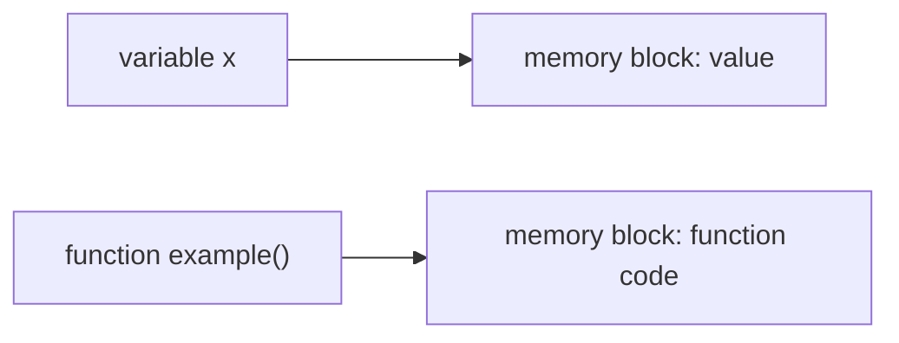
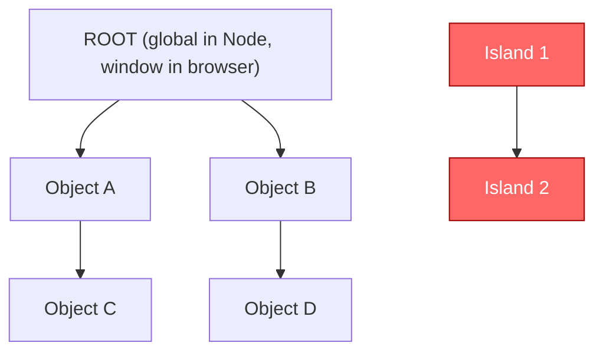
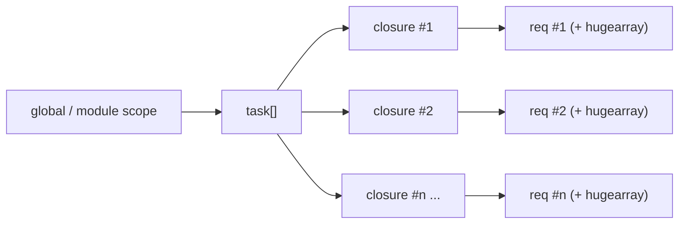
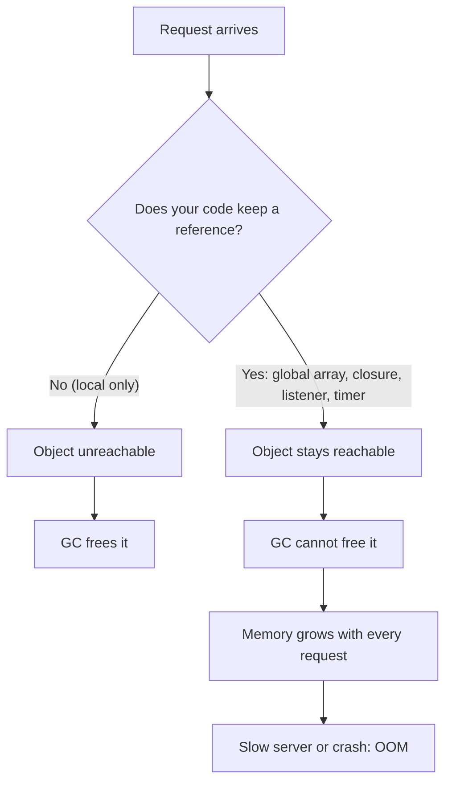

## 1. Memory basics: variables are references

A variable does not "contain" a big object. It **points** to a place in memory (the heap).



- Primitives, objects, arrays and **functions** all live in memory.
- Each name (variable) is an arrow pointing to a block.
- As long as **some arrow still leads to a block**, that block must stay alive.

> [!question] How does Node know when to remove something? Through the **garbage collector** built into the **V8** JavaScript engine.

---

## 2. Garbage Collection and Mark & Sweep

### 2.1 The heap is a graph (a "tree of nodes")



- **Root**: `global` in Node.js (`window` in the browser).
- Everything **reachable** from the root = alive.
- An **"island"** = objects with no path from the root. They are garbage.

### 2.2 Mark and Sweep

|Phase|What happens|
|---|---|
|**Mark**|Start at the root, walk every reference, mark everything you reach as "alive".|
|**Sweep**|Anything not marked (islands) gets deleted and its memory is released.|

> [!tip] Key idea The GC does **not** ask "is this still useful?". It only asks "**can I still reach it from the root?**" So if _you_ keep a reference by accident, the GC assumes you still need it.

### 2.3 V8 generations (what `Scavenge` and `Mark-sweep` mean in `--trace-gc`)

|Space|Contains|GC type|Speed|
|---|---|---|---|
|**Young generation**|Newly created objects|**Scavenge** (minor GC)|Very fast, frequent|
|**Old generation**|Objects that survived a few GCs|**Mark-Sweep / Mark-Compact** (major GC)|Slower, less frequent|

Objects that survive young-gen collections get promoted to old-gen. A leak is mostly objects piling up in old-gen.

---

## 3. What is a memory leak?

> [!danger] Definition A memory leak is memory that is **no longer needed** by your program but is **still reachable**, so the GC cannot free it.

### Symptoms

- Memory usage keeps growing over time.
- Server gets slower (more GC work, more swapping).
- Eventually: `JavaScript heap out of memory` crash.
- Often you **don't notice** until production load hits.

### What the memory graph looks like

```text
Healthy (sawtooth)            Leak (staircase)

mem                           mem            ____/
 |  /\  /\  /\                 |        ____/
 | /  \/  \/  \                |   ____/
 |/                            |__/
 +-------------- time          +-------------- time
 goes up, GC drops it back     each GC cycle ends HIGHER than the last
```

> [!warning] Tricky leaks Slow leaks look healthy at first: memory is collected each cycle, but every cycle's **floor** is slightly higher than the previous one. Compare minimums over a long period, not single peaks.

---

## 4. Common causes of leaks

|#|Cause|Why it leaks|Fix|
|---|---|---|---|
|1|**Global variables**|Attached to the root, always reachable, never freed|Avoid globals; keep state local or in a bounded cache|
|2|**Closures** holding big objects|A closure keeps every outer variable it uses alive as long as the closure itself is reachable|Copy only the small value you need; drop references|
|3|**Uncleared timers** (`setInterval` / pending `setTimeout`)|The timer holds its callback, which holds its closure|`clearInterval` / `clearTimeout`|
|4|**Event listeners not removed**|The emitter holds a reference to each listener|`removeListener` / `off`, or `once`, or register only once|
|5|**Unbounded caches / huge arrays**|Data is added forever, never evicted|Use LRU/TTL cache (`node-cache`, `lru-cache`, Redis, memcached)|
|6|**Cyclic references**|Modern V8 handles cycles fine, but they make graphs hard to reason about|Avoid anyway; they can keep big objects alive if one side is reachable|
|7|**Detached/unreferenced nodes (browser)**|DOM nodes removed from the page but still referenced in JS|Null out references|

---

## 5. Code walkthrough: every leak in the demo

### 5.1 The original code

```js
const express = require('express')
const app = express()
const port = 3000
const emitter = require('events')
const { EventEmitter } = require('stream')
const { setTimeout } = require('timers')
const eventEmitter = new EventEmitter()
let task = []                                   // (A) global array

app.get('/', (req, res) => {
  // (B) closure with an external variable reference
  task.push(function () {
       return req.headers
    })

  // (C) huge array filled with the request object
  const hugearray = new Array(100000000).fill(req)

  // (D) cyclic reference + attaching the huge array to req
  req.user = {
    id: 1,
    username: 'inefficient user',
    badobject: req,
    hugearray
  }

  // (E) listener added on EVERY request, never removed
  eventEmitter.on('start', () => {
    console.log('Useless event')
  })

  // (F) timer never cleared
  setTimeout(() => {
    console.log('Userless event emitted')
  })
})

app.listen(port, () => {
  console.log('Port is running in 3000')
})
```

### 5.2 Leak-by-leak explanation

#### (A) + (B): Global `task` array holding closures

- `task` lives for the whole life of the process, so it is **always reachable**.
- Every request pushes a **new function** into it.
- Each function is a **closure** that references `req`. A closure keeps `req` (and everything attached to `req`, including `req.user.hugearray`!) alive.
- Result: **every request ever made is retained forever**. This is the main leak.



> [!note] About "closures are ambiguous for the GC" The video says the GC can't tell if a callback "has finished". More precisely: the GC doesn't care whether it finished. It only cares whether the **closure object is reachable**. Here it is reachable through `task`, so everything it captured stays alive.

#### (C) Huge array: `new Array(100000000).fill(req)`

- 100 million slots. On 64-bit V8 each slot is roughly **8 bytes**, so about **800 MB per request** just for the array backing store (the elements all point to the same `req`).
- Per-request allocation like this is dangerous even without a leak. With the leak in (A)/(B), it is never freed.
- The video's advice: don't store big data in process memory ad hoc; use a **cache** (`node-cache`, `lru-cache`, Redis, memcached). Browsers have localStorage/sessionStorage, Node has no built-in equivalent.

#### (D) Cyclic reference: `badobject: req` inside `req.user`

- `req.user.badobject` points back to `req`, a **cycle** (`req -> user -> req`).
- V8's mark-and-sweep handles cycles correctly: if nothing outside the cycle references it, the whole cycle is collected.
- But it is a **bad pattern**: it makes JSON serialization fail (`Converting circular structure to JSON`), makes debugging harder, and if anything reachable holds one node of the cycle, the whole structure stays.

#### (E) Event emitter listener added per request

- `eventEmitter.on('start', ...)` inside the route handler adds **one more listener per request**.
- The emitter stores all listeners in an internal array, so they pile up forever.
- Node prints `MaxListenersExceededWarning` after 10 listeners on one event, a strong hint of this leak.
- Fix: register the listener **once at startup**, or use `once`, or remove with `removeListener` / `off`.

```js
const handler = () => console.log('Useless event')
eventEmitter.on('start', handler)
// when no longer needed:
eventEmitter.removeListener('start', handler) // or eventEmitter.off('start', handler)
```

#### (F) `setTimeout` never cleared

- Store the timer id and clear it when done: `const t = setTimeout(...); clearTimeout(t)`.

> [!note] Nuance A one-shot `setTimeout` that has already **fired** is released by Node. The real danger is:
> 
> - `setInterval` that is never cleared (runs forever, keeps its closure alive), and
> - a **pending** `setTimeout` with a long delay whose closure holds large data.
> 
> In the demo, the timeout has no delay (so about 1 ms) and fires quickly, so it is not the biggest leak, but clearing timers is still the right habit.

### 5.3 Other problems in the demo code

|Issue|Why it matters|
|---|---|
|No `res.send()` / `res.end()`|The request **never finishes**; connections and `req`/`res` objects pile up (a leak of its own)|
|`const emitter = require('events')` unused|Dead code|
|`const { EventEmitter } = require('stream')`|Should be `require('events')`. `EventEmitter` belongs to the `events` module|
|`const { setTimeout } = require('timers')`|Unnecessary; `setTimeout` is already global|
|Variable named `task` but video says "tasks"|Just a naming slip in the transcript|

### 5.4 Fixed version

```js
const express = require('express')
const { EventEmitter } = require('events')

const app = express()
const port = 3000
const eventEmitter = new EventEmitter()

// Listener registered ONCE, not per request
eventEmitter.on('start', () => {
  console.log('Event received')
})

app.get('/', (req, res) => {
  // Copy only the small value you need; don't capture the whole req
  const userAgent = req.headers['user-agent']

  // Keep the timer id so it can be cleared if the client disconnects
  const timer = setTimeout(() => {
    eventEmitter.emit('start')
  }, 1000)

  res.on('close', () => clearTimeout(timer))

  // No global array, no giant per-request allocation, no cyclic refs
  res.json({ ok: true, userAgent })
})

app.listen(port, () => {
  console.log(`Port is running on ${port}`)
})
```

> [!success] What changed
> 
> - Removed the global `task` array, so nothing accumulates.
> - Closure captures a small string, not the whole `req`.
> - Removed the 100M-element array and the cyclic `badobject`.
> - Listener registered once.
> - Timer cleared on disconnect.
> - The response is actually sent.

---

## 6. How to detect and debug memory leaks

### 6.1 `--trace-gc` (quick look at GC activity)

```bash
node --trace-gc index.js
```

- Prints a line for every GC, e.g. `Scavenge 81.2 (90.1) -> 76.4 (92.0) MB`.
- Format: _heap used before -> heap used after_.
- If the "after" number keeps creeping up, you likely have a leak.

### 6.2 Stress test (reproduce the leak)

A shell script that hits the endpoint in a tight loop:

```bash
#!/bin/bash
# stress-test.sh
while true; do
  curl -s http://localhost:3000/ > /dev/null
  sleep 0.001
done
```

In the demo: memory went 81 -> 86 -> 91 -> **101 MB**, then dropped to ~70 after a GC. The GC works, but each cycle ends higher over time, which is the staircase pattern.

### 6.3 Chrome DevTools heap snapshots (`--inspect`)

```bash
node --inspect index.js
```

1. Open `chrome://inspect` in Chrome.
2. Click **inspect** under your Node target.
3. Go to the **Memory** tab and take **Heap snapshot** #1.
4. Run the stress test for a while.
5. Take **Heap snapshot** #2.
6. Select snapshot 2 and set the view to **Comparison** (against snapshot 1).
7. Sort by **Size Delta**. Big, always-positive deltas are your suspects.
8. Expand entries (in the demo: many `Array` objects of the same size) and check **Retainers** to see _what keeps them alive_. That leads you to the global `task` array.

> [!tip] Reading the demo result Snapshot 1 = 61 MB, snapshot 2 = 93 MB. Many arrays of identical size meant "something is appending to an array each request", which was `task`.

### 6.4 PM2 monitoring (good for production)

```bash
npx pm2 start index.js
npx pm2 logs      # view logs
npx pm2 monit     # live CPU + memory dashboard
npx pm2 stop index
```

- Shows per-process CPU and memory in real time.
- Can **auto-restart** on crash or when memory passes a limit: `pm2 start index.js --max-memory-restart 300M`.
- Great in Docker/production, but restarting only **hides** the leak; you still need to fix it.

### 6.5 Other tools

|Tool|Use|
|---|---|
|`process.memoryUsage()`|Log `heapUsed`, `rss`, `external` from inside the app|
|`v8.writeHeapSnapshot()`|Save a snapshot from code (e.g. on a signal) for offline analysis|
|`--max-old-space-size=<MB>`|Raise or cap the old-gen heap limit|
|`clinic.js` (`clinic heapprofiler`, `clinic doctor`)|Higher-level diagnostics|
|`heapdump`, `memwatch-next`|Community helpers|

```js
setInterval(() => {
  const m = process.memoryUsage()
  console.log(`heapUsed: ${(m.heapUsed / 1024 / 1024).toFixed(1)} MB`)
}, 5000).unref() // unref so this timer doesn't keep the process alive
```

---

## 7. Prevention checklist

- [ ] No unnecessary **global/module-level mutable state** (arrays, maps, objects that grow)
- [ ] Any cache has a **size limit and/or TTL** (LRU)
- [ ] Every `setInterval` has a matching `clearInterval`; clear long `setTimeout`s on cleanup
- [ ] Every `emitter.on(...)` has a matching `off/removeListener`, or uses `once`, or is registered once
- [ ] Closures capture **only what they need** (a string, not the whole `req`)
- [ ] Don't attach large data to `req`/`res`
- [ ] Always **end the response**
- [ ] Avoid cyclic structures
- [ ] Monitor memory in production (`pm2 monit`, metrics/APM, alerts)
- [ ] Load test before release and compare heap snapshots

---

## 8. Corrections / clarifications on the transcript

> [!info] The transcript is auto-generated, so a few phrases are garbled
> 
> - "Quantum development" most likely means _"when developing"_.
> - "Chrome column slash classes inspect" = `chrome://inspect`.
> - "Trace underscore GC" = `--trace-gc` (also accepted as `--trace_gc`).
> - "Third body packages" = _third-party packages_.
> - "clear time mod" = `clearTimeout`.
> - "Event image" = just a variable name (`eventEmitter`).
> - "Snapchat" = _snapshot_.

---

## 9. Flashcards (Spaced Repetition plugin)

What is a memory leak in Node.js?:: Memory that is no longer needed but is still reachable from the root, so the GC cannot free it. #flashcards

What does the GC use to decide what to free?:: Reachability from the root object (`global`), via Mark and Sweep. #flashcards

What is the root object in Node.js vs the browser?:: `global` in Node.js, `window` in the browser. #flashcards

What does a leak look like on a memory graph?:: A staircase: memory rises in steps and each GC cycle ends higher than the last. #flashcards

Why are global variables a leak risk?:: They are attached to the root, so they are always reachable and never collected. #flashcards

Why do closures cause leaks?:: A closure keeps every outer variable it references alive for as long as the closure itself is reachable. #flashcards

How do you avoid event listener leaks?:: Register once, use `once`, or remove with `off` / `removeListener`. #flashcards

What does `--trace-gc` show?:: Each GC event with heap size before and after collection. #flashcards

How do you compare memory in Chrome DevTools?:: Take two heap snapshots, use Comparison view, and sort by Size Delta. #flashcards

What does `pm2 monit` do?:: Shows live CPU and memory for processes; PM2 can also auto-restart on crash or memory limit. #flashcards

What is Scavenge in V8?:: A fast minor GC for the young generation. #flashcards

---

## 10. Quick summary diagram

