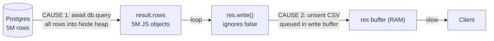
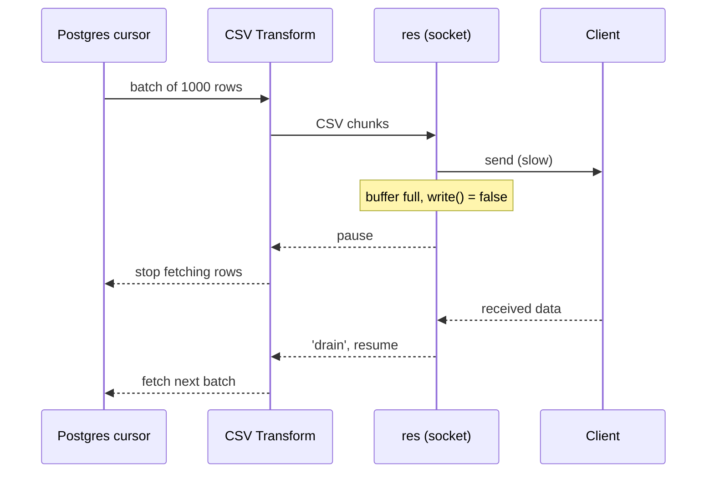

## 1. The exam question

> **Question 4. Streams and backpressure** 

```js
app.get('/export.csv', async (req, res) => {
  const result = await db.query('SELECT * FROM events'); // 5M rows
  res.write(HEADER);
  for (const row of result.rows) res.write(toCsv(row));
  res.end();
});
```

**(a)** This code can crash the pod with an out-of-memory error in two separate ways. One happens even when the client downloads fast. The other happens only when the client downloads slowly. Identify both, and explain how each one fills up memory.

**(b)** Write the corrected version: read rows from Postgres as a stream (cursor / `pg-query-stream`) and send them to the response using `stream.pipeline`, so that backpressure is respected. Code or clear pseudocode.

---

## 2. Concepts you need first

### 2.1 Memory and the pod limit

- Every value in your program (arrays, objects, strings) lives in **RAM**.
- A **pod** (Kubernetes container) has a **memory limit**. Exceed it and the process is killed: **OOM (out-of-memory)**.
- Data is freed only when nothing references it any more. Anything you keep in a variable **stays in RAM**.

### 2.2 What is a stream?

A stream processes data **piece by piece** instead of all at once.

> [!example] Analogy **No streaming:** carry 5 million bricks across a room in one trip, which needs a gigantic truck. **Streaming:** carry a small batch, put it down, fetch the next. You only ever hold a few bricks.

Four kinds of stream in Node.js:

|Type|Direction|Example|
|---|---|---|
|**Readable**|produces data|file read, DB query stream|
|**Writable**|consumes data|HTTP response `res`, file write|
|**Duplex**|both|TCP socket|
|**Transform**|reads, changes, writes|row object to CSV line|

> [!note] In Express, **`res` is a Writable stream**.

### 2.3 Producer vs consumer

```
 Producer  ───►  [ buffer in RAM ]  ───►  Consumer
 (your loop)                              (client over the network)
```

- They rarely run at the same speed. The server may produce ~100 MB/s while a slow client receives ~1 MB/s.
- The difference has to wait **somewhere**: in a **buffer in RAM**.

### 2.4 What `res.write()` really does

1. Hands data to `res`.
2. `res` tries to push it to the network socket.
3. If the socket can't take it yet, `res` **stores it in its internal buffer (RAM)** and sends it later.

The buffer has a soft limit called **`highWaterMark`** (default about **16 KB**; 16 objects in object mode).

### 2.5 Backpressure

|`res.write()` returns|Meaning|
|---|---|
|`true`|Buffer below the limit. Keep writing.|
|`false`|Buffer at or above the limit. **Stop writing** until `'drain'` fires.|

- **`'drain'` event**: "my buffer has emptied, you can continue".
- **Backpressure** = this stop and resume signalling from the slow consumer to the fast producer.

> [!warning] The key trap `false` is only a **request**. Node still accepts and stores everything you write. If you ignore it, the buffer grows **without any hard limit** until the pod runs out of memory.

> [!example] Analogy A tap filling a bucket. If the bucket is nearly full, you must **turn the tap off** until it drains. Ignoring that means the water floods the room (RAM).

### 2.6 Numbers example

Each row becomes 100 bytes of CSV, 5M rows = **500 MB** total.

||Fast client (200 MB/s)|Slow client (1 MB/s)|
|---|---|---|
|Loop produces|100 MB/s|100 MB/s|
|Client consumes|200 MB/s|1 MB/s|
|Buffer|stays near empty|grows ~99 MB every second|
|After the loop finishes (~5 s)|tiny|~495 MB still queued in RAM|

The `for` loop never pauses by itself, so it dumps all 5M writes immediately.

---

## 3. Part (a): the two OOM causes



### Cause 1: loading the whole result set (happens even with a fast client)

- `await db.query('SELECT * FROM events')` returns **everything at once**.
- All **5 million rows** become JS objects in the array `result.rows`, in the heap.
- Each row object has overhead (property names, pointers, strings), so easily **hundreds of bytes per row**. 5M x a few hundred bytes = **gigabytes** of RAM.
- This depends only on the **table size**, not the client. The memory is already used **before the first byte is sent**, and `result.rows` can't be freed until the handler finishes.

### Cause 2: no backpressure on `res.write()` (only with a slow client)

- The loop calls `res.write(toCsv(row))` 5M times and **never checks the return value or waits for `'drain'`**.
- A slow client can't receive data as fast as the loop produces it, so `write()` returns `false`, which the code ignores.
- Every unsent chunk is **queued in `res`'s internal buffer in RAM**, with no hard cap.
- Memory grows by **(data produced) minus (data the client has received)**. The slower the client, the bigger the backlog, until OOM.

### Comparison

||Cause 1: `await db.query`|Cause 2: no backpressure|
|---|---|---|
|What fills memory|5M row objects in `result.rows`|Queued CSV chunks in `res` write buffer|
|When|Always, even with a fast client|Only when the client is slower than the server|
|Root reason|Whole result set loaded up front|`write()` returning `false` is ignored; no wait for `'drain'`|
|Memory used|**Before** sending|**During** sending|

### Model answer to write in the exam

> **(a)** The first failure is caused by `await db.query('SELECT * FROM events')`. It loads all 5 million rows into the Node process's heap as JavaScript objects in `result.rows` before anything is sent. Each row object has overhead beyond its raw data, so this takes gigabytes of RAM and can exceed the pod's memory limit. It happens even when the client downloads quickly, because it depends only on the size of the table, and `result.rows` remains referenced until the handler finishes.
> 
> The second failure is the lack of backpressure in the `res.write()` loop. `res` is a writable stream with a limited internal buffer (`highWaterMark`). When the client downloads slowly, the socket cannot send data as fast as the loop produces it, so `res.write()` returns `false`, signalling that the producer should stop and wait for `'drain'`. The code ignores this and keeps writing, so every unsent CSV chunk is queued in memory in the response buffer. The buffer grows without bound until the process runs out of memory. This only occurs when the client is slower than the server.

---

## 4. Part (b): the corrected version

### 4.1 Idea (pseudocode)

```text
get a DB connection from the pool
open a cursor on "SELECT * FROM events"        // pg-query-stream, reads batches (e.g. 1000 rows)
make a Transform stream: row object -> CSV line
set response headers (Content-Type: text/csv)
push HEADER as the first line
pipeline( cursorStream  ->  csvTransform  ->  res )
    // pipeline pauses the cursor when res is full (backpressure)
    // pipeline resumes it on 'drain'
    // pipeline ends res when the cursor is done
    // pipeline destroys everything if an error occurs or the client disconnects
release the DB connection (always, in finally)
```

### 4.2 Real code

```js
const { pipeline } = require('node:stream/promises');
const { Transform } = require('node:stream');
const QueryStream = require('pg-query-stream');

app.get('/export.csv', async (req, res) => {
  const client = await pool.connect();          // dedicated connection for the cursor

  try {
    // 1) Readable stream of rows, fetched from Postgres in small batches via a cursor
    const query = new QueryStream('SELECT * FROM events', [], { batchSize: 1000 });
    const rows = client.query(query);

    // 2) Transform: row object  ->  CSV text line
    const csv = new Transform({
      writableObjectMode: true,                 // input = objects (rows), output = text
      transform(row, _encoding, callback) {
        callback(null, toCsv(row));
      },
    });
    csv.push(HEADER);                           // header goes out first

    res.setHeader('Content-Type', 'text/csv');
    res.setHeader('Content-Disposition', 'attachment; filename="events.csv"');

    // 3) Connect them. pipeline handles backpressure, ending and cleanup.
    await pipeline(rows, csv, res);

  } catch (err) {
    // Headers may already be sent, so we can't always send a 500
    if (!res.headersSent) {
      res.status(500).send('Export failed');
    } else {
      res.destroy(err);
    }
    console.error('Export error:', err);
  } finally {
    client.release();                           // ALWAYS give the connection back
  }
});
```

### 4.3 Why this fixes both causes

|Cause|How the fix solves it|
|---|---|
|**1: all rows in RAM**|`pg-query-stream` uses a **database cursor**: Postgres keeps the result and Node fetches only `batchSize` (about 1000) rows at a time. Only a small batch is ever in memory.|
|**2: ignoring backpressure**|`pipeline` connects the streams. When `res`'s buffer is full, `res.write()` returns `false` internally, `pipeline` **pauses** the `csv` stream, which pauses the cursor so **no more rows are fetched**. On `'drain'` everything resumes.|

Memory is roughly: `batchSize` rows + a few 16 KB buffers, **constant**, whatever the table size or client speed.



### 4.3b Why `pipeline` and not `.pipe()` or a manual loop?

|Approach|Backpressure|Error / disconnect handling|
|---|---|---|
|`for` loop + `res.write` (original)|No|No|
|Manual loop with `await once(res, 'drain')`|Yes|You must write it yourself|
|`a.pipe(b).pipe(res)`|Yes|**No cleanup on errors**: streams can leak, and the cursor may stay open|
|**`stream.pipeline`**|Yes|**Yes**: destroys all streams and rejects the promise on error or client disconnect|

### 4.4 Alternative: manual backpressure (acceptable if the question allowed it, but (b) asks for `pipeline`)

```js
const { once } = require('node:events');

for await (const row of rows) {               // rows = QueryStream
  if (!res.write(toCsv(row))) {
    await once(res, 'drain');                 // wait until the buffer empties
  }
}
res.end();
```

### 4.5 Details worth mentioning for extra marks

- **`batchSize`**: trade-off. Larger means fewer DB round trips but more memory; smaller means the opposite.
- **Client disconnect**: `pipeline` destroys the cursor stream so Postgres stops sending, and `finally` releases the pooled connection.
- **Dedicated connection**: the cursor holds a connection for the whole export, so use `pool.connect()` and release it. Don't use `pool.query()` for this.
- **Object mode**: DB rows are **objects**, so the transform's writable side uses `writableObjectMode: true`. `highWaterMark` then counts **objects** (default 16), not bytes.
- **`LIMIT`/pagination** is a different approach and doesn't remove the need for backpressure on the write side.
- **Compression** (`zlib.createGzip()`) can be added as another stage: `pipeline(rows, csv, gzip, res)`.

### 4.6 Marking scheme guess (10 marks)

|Part|Marks (approx.)|
|---|---|
|(a) Cause 1: whole result in memory, with explanation|2 to 3|
|(a) Cause 2: ignored backpressure / unbounded write buffer, slow client|2 to 3|
|(b) Uses `pg-query-stream` / cursor|1 to 2|
|(b) Uses `stream.pipeline` with Transform to CSV, piped to `res`|2|
|(b) Explanation of how backpressure is respected|1|

---

## 5. Cheat sheet

- **Heap/RAM** is limited by the pod. **OOM** kills the process.
- **Stream** = small pieces. **`res`** is a Writable stream.
- `write()` returns `false` -> **stop**; wait for **`'drain'`**.
- **`highWaterMark`**: soft buffer limit (16 KB, or 16 objects in object mode).
- **Cursor** = fetch DB rows in batches. **Transform** = convert chunks. **`pipeline`** = connect with automatic backpressure and cleanup.
- **Problem 1** = memory used **before** sending (all rows loaded).
- **Problem 2** = memory used **during** sending (unsent data queued).

---

## 6. Flashcards (Spaced Repetition plugin)

What is a stream in Node.js?:: A way to process data in small chunks instead of loading it all into memory at once. #flashcards

What type of stream is `res` in Express?:: A Writable stream. #flashcards

What does `res.write()` returning `false` mean?:: The internal buffer is full; the producer should stop writing and wait for `'drain'`. #flashcards

What is backpressure?:: A slow consumer signalling a fast producer to pause, so data doesn't pile up in memory. #flashcards

What happens if you ignore `write()` returning `false`?:: Node keeps buffering the data in RAM without a hard limit, which can cause OOM. #flashcards

What is `highWaterMark`?:: The soft size limit of a stream's internal buffer (default 16 KB, or 16 objects in object mode). #flashcards

What does the `'drain'` event signal?:: The buffer has emptied and the producer may resume writing. #flashcards

Why does `await db.query('SELECT * ...')` cause OOM on 5M rows?:: It loads the entire result set into the Node heap as JS objects before anything is sent. #flashcards

Why does the OOM from `db.query` occur even with a fast client?:: It depends only on the table size, not on how fast the client downloads. #flashcards

What does `pg-query-stream` do?:: It reads query results through a database cursor in small batches, as a Readable stream of rows. #flashcards

Why prefer `stream.pipeline` over `.pipe()`?:: `pipeline` handles errors and client disconnects by destroying all streams and cleaning up, and it applies backpressure. #flashcards

Which two causes make the export crash the pod?:: (1) The whole result set loaded into memory; (2) ignoring backpressure when writing to a slow client. #flashcards

---

## 7. Common mistakes to avoid in the exam

- [ ] Saying both problems are "the same memory issue". They are separate: **before sending** vs **during sending**.
- [ ] Saying `write()` blocks or throws when the buffer is full. It does neither; it returns `false` and keeps buffering.
- [ ] Using `LIMIT/OFFSET` pagination as the fix for backpressure. It doesn't address the slow-client problem.
- [ ] Forgetting to release the DB client in `finally`.
- [ ] Using `.pipe()` and claiming it handles errors. It doesn't; `pipeline` does.
- [ ] Forgetting a Transform from row objects to CSV text (`res` can't accept row objects).