# 🧠 But what is a neural network? — Deep Learning 

> [!abstract] TL;DR A neural network is **one giant function**: it takes in **784 numbers** (pixels of a 28×28 image) and returns **10 numbers** (how much it thinks the image is each digit 0–9). Inside, **neurons** hold numbers (activations) between 0 and 1, arranged in **layers**. Each layer is computed from the previous one using **weights**, **biases** and a **squishing function**:
> 
> $$a^{(1)} = \sigma!\left(W,a^{(0)} + b\right)$$
> 
> This network has **13,002** tunable weights and biases. _Learning_ = finding good values for all of them (next chapter → [[Gradient Descent]]).

## 🧭 Big picture (mind map)

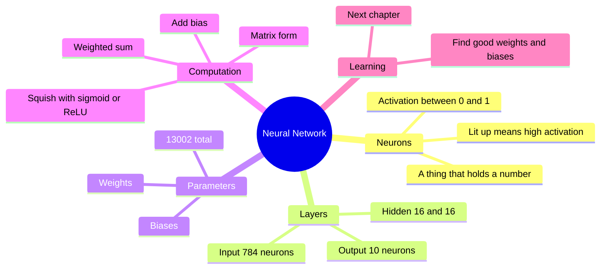

---

## 1. The problem

- Your brain instantly recognises a **3**, even when it is sloppily written and rendered at a tiny **28×28 pixel** resolution.
- Every "3" lights up _different_ light-sensitive cells in your eye, yet your visual cortex resolves them all to the **same idea**.
- But try writing a program that takes a **28×28 grid of pixels** and outputs **one number 0–9** — a task that feels trivial for you suddenly becomes very hard to write down as code.

> [!important] Key insight Recognising digits is effortless for your brain, yet it is nearly impossible to spell out _how_ using ordinary programming tools like `if` statements and loops.

> [!tip] The hope Write **brain-inspired software** (a neural network), and instead of giving it instructions, show it **many labelled examples** and let it adapt. That is the "learning" in _machine learning_.

> [!note] Not identical to the brain Neural networks are _inspired_ by the brain but are not the same thing — think "bird vs airplane": same goal, roughly similar strategy, very different details.[^2]

---

## 2. What this series covers

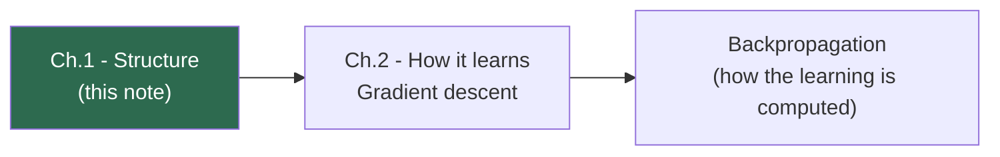

- **This video:** _what_ a neural network is — neurons, layers, the math of one layer feeding the next.
- **Next:** _how_ the weights and biases are found from data (see [[Gradient Descent]] and [[Backpropagation]]).

> [!tip] Start with the vanilla version There are many variants — CNNs, RNNs, transformers, … — but each starts from the simplest **plain vanilla** form with no added frills. That is what this chapter builds.

---

## 3. Neurons

> [!abstract] Definition (for now) **Neuron = "a thing that holds a number"** — specifically a number between **0.0 and 1.0**. That number is called its **activation**. Picture the neuron _lit up_ when the activation is high.

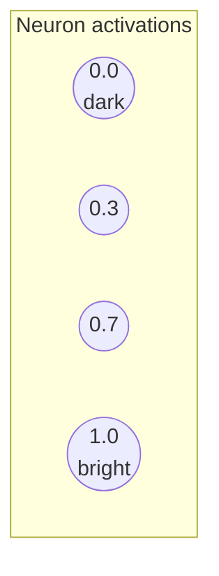

### Input layer: pixels → neurons

- Image = **28 × 28 = 784 pixels**.
- Each pixel has a brightness: **0.0 (black) → 1.0 (white)**.
- ⇒ the **input layer has 784 neurons**, one per pixel. Feed an image in by setting each neuron's activation to its pixel's brightness.

### Output layer: 10 neurons

- **10 neurons**, one per digit `0 … 9`.
- Each activation (again 0–1) = _how much the network thinks the image is that digit_.
- The **brightest** output neuron is the network's answer.

> [!question]- Self-check: reading the output If the output neurons were `[0.02, 0.01, 0.05, 0.93, 0.01, 0.03, 0.02, 0.01, 0.04, 0.02]`, which digit and how confident?
> 
> **Digit 3** — its neuron is brightest (≈0.93), so the network is quite confident. _(Illustrative numbers made up for this note.)_

---

## 4. Layers

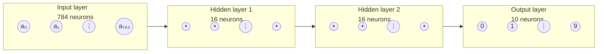

- Between input and output sit the **hidden layers** — for now, "a giant question mark" for _how_ digits get recognised.
- This network: **2 hidden layers × 16 neurons**.

> [!warning] Arbitrary choices The **2 layers** and **16 neurons** are admittedly _arbitrary_: 2 layers was chosen to motivate the structure, and 16 was "a nice number to fit on the screen". In practice there is lots of room to experiment.

- Every neuron in one layer is **connected to every neuron in the next** (a "fully connected" / plain vanilla network).
- ==The activations in one layer determine the activations in the next== — like neurons in the brain, where some firing causes others to fire.
- But the connections are **not equal**: some are stronger than others. Working out _how strong_ is the heart of how a network works.

**Network size at a glance**

|Layer|# neurons|
|---|---|
|Input|784|
|Hidden 1|16|
|Hidden 2|16|
|Output|10|
|**Total**|**826**|

---

## 5. Why layers?

> [!question] The question Why would a layered structure behave _intelligently_? Why not wire pixels straight to the 10 outputs?

**The hope: each layer handles a level of abstraction.** When _you_ recognise digits you piece together components like **loops** and **lines** (e.g. 9 = loop on top + line; 8 = two loops; 4 = lines).

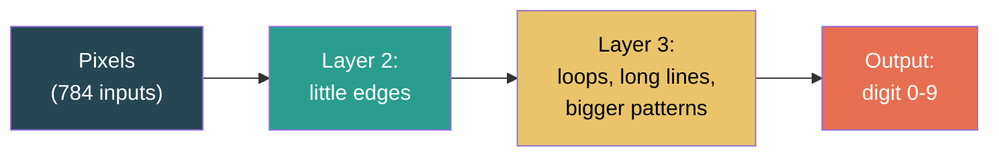

- Hope for the **second-to-last layer**: one neuron per subcomponent. _Any_ loopy pattern near the top ⇒ the "top loop" neuron ≈ 1.0 (not just one exact loop of pixels!).
- Then the last layer only has to learn **which combinations of subcomponents ⇒ which digit**.
- But recognising a loop is itself a subproblem: it breaks into **edges**. A long line (in 1, 4, 7) is just a long edge or several small ones.
- So the hope for the **first hidden layer**: neurons that detect **little edges**.

> [!caution] It's a _hope_, not a guarantee This is how we'd _like_ it to work. Whether the trained network actually does this is revisited after learning is covered (it **falls short of some hopes**).

### The idea generalises

|Task|Layers of abstraction|
|---|---|
|**Digit recognition**|pixels → edges → loops/lines → digits|
|**Other image tasks** (e.g. the lion photo)|edge detection is a useful early step for all image recognition|
|**Speech parsing**|raw audio → distinct sounds → syllables → words → phrases → abstract thoughts|

> [!success] Why layers are great They **break a hard problem into bite-sized steps**, so going from _one layer to the next_ is relatively straightforward.

---

## 6. One neuron in detail - edge detection

**Goal:** make one neuron in layer 2 light up if the image has an **edge in one specific spot**.

**Knobs we give it:** a **weight** on every connection from the 784 input neurons (just numbers).

- **Positive weight** → "if that input neuron is on, I should be on too."
- **Negative weight** → "if that input neuron is on, I should be off."
- Visual convention: 🟦 **blue = positive**, 🟥 **red = negative**, brightness = size.

### Step 1 – weighted sum

$$ z = w_1 a_1 + w_2 a_2 + w_3 a_3 + \cdots + w_n a_n $$

### Step 2 – building an edge detector with weights

|Attempt|Weights|Result|
|---|---|---|
|1|Positive only on the pixels in the target region, **0 everywhere else**|Sum = adds up brightness in the region. **Problem:** also fires for a big blob of bright pixels|
|2|Positive in the region **+ negative on the surrounding pixels**|Largest when the central pixels are **bright** and the surrounding pixels are **dark** ⇒ a true narrow edge|

### Step 3 – squish with the sigmoid

The weighted sum can be _any_ number, but we want an activation in **0 … 1**. So pass it through a squishing function — the **sigmoid** (a.k.a. logistic curve):

$$ \sigma(x) = \frac{1}{1 + e^{-x}} $$

- Very **negative** inputs → close to **0**
- Very **positive** inputs → close to **1**
- Steady increase around **0**
- ⇒ activation ≈ _"how positive is the weighted sum?"_

|$x$|$\sigma(x)$ (rounded)|
|---|---|
|−10|0.00005|
|−2|0.119|
|0|0.5|
|2|0.881|
|10|0.99995|

### Step 4 – add a bias

Maybe we only want the neuron to light up when the weighted sum is **bigger than, say, 10**. So add a **bias** (e.g. −10) _before_ the sigmoid:

$$ a = \sigma!\left(w_1 a_1 + w_2 a_2 + \cdots + w_n a_n ;-; 10\right) $$

> [!abstract] Weights vs bias
> 
> - **Weights** → _which pixel pattern_ this neuron picks up on.
> - **Bias** → _how big the weighted sum must be_ before the neuron becomes meaningfully active.

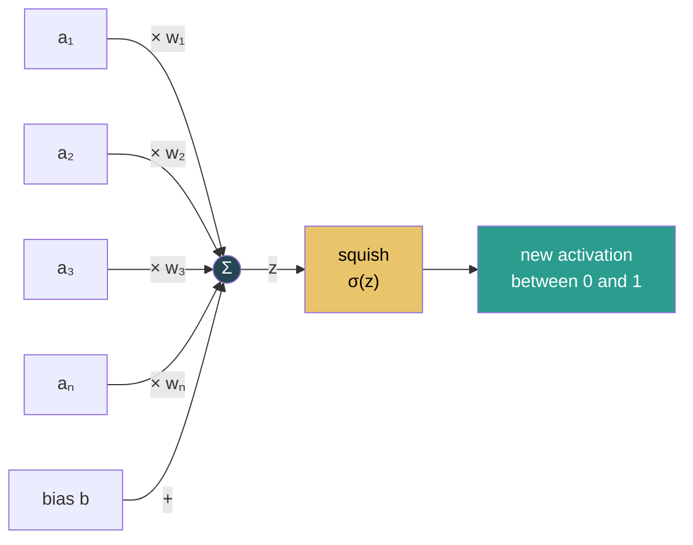

> [!example] Tiny worked example (made up for this note, not from the video) Three inputs $a = (0.9,\ 0.1,\ 0.8)$, weights $w = (2,\ -1,\ 1.5)$, bias $b = -2$.
> 
> $z = 2(0.9) + (-1)(0.1) + 1.5(0.8) - 2 = 1.8 - 0.1 + 1.2 - 2 = 0.9$
> 
> Sigmoid: $\sigma(0.9) = \dfrac{1}{1+e^{-0.9}} \approx 0.711$ ReLU (see [[#12. ReLU vs Sigmoid]]): $\max(0,,0.9) = 0.9$

---

## 7. Counting weights and biases

Each neuron in a layer connects to **all** neurons of the previous layer ⇒ one weight per connection, plus **one bias per neuron**.

|Transition|Weight matrix $W$ shape|# weights|# biases|
|---|---|---|---|
|Input (784) → Hidden 1 (16)|$16 \times 784$|784 × 16 = **12,544**|16|
|Hidden 1 (16) → Hidden 2 (16)|$16 \times 16$|16 × 16 = **256**|16|
|Hidden 2 (16) → Output (10)|$10 \times 16$|16 × 10 = **160**|10|
|**Total**||**12,960**|**42**|

$$ 12{,}960 + 42 = \boxed{13{,}002} $$

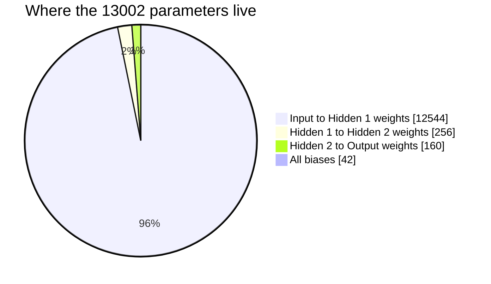

> [!tip] Notice Almost **96.5%** of all parameters sit in the very first connection (12,544 / 13,002 ≈ 96.5%) simply because the input layer is so wide.

---

## 8. How learning relates

> [!abstract] Definition **Learning** = getting the computer to find a good setting for **all 13,002 weights and biases** so it solves the problem. (Exactly _how_ → next chapter.)

**Thought experiment** (fun _and_ horrifying): set all 13,002 knobs **by hand** — weights for layer 2 detect edges, layer 3 detect patterns, and so on.

> [!success] Why bother picturing it?
> 
> - If the network **misbehaves**, a feel for what the weights/biases _mean_ gives you a starting point for improving the structure.
> - If it **works but not for the reasons you expected**, digging into the weights is a way to challenge your assumptions and see the full space of possible solutions.

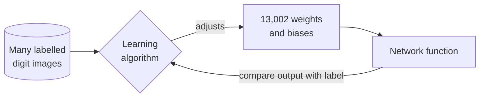

> [!info] Preview The loop above is the story of [[Gradient Descent]] and [[Backpropagation]].

---

## 9. Notation and linear algebra

Writing out one neuron at a time is cumbersome (lots of indices), so we compute **a whole layer at once** with matrix multiplication.

**Setup** — previous layer has $n+1$ neurons (indices $0 \ldots n$), next layer has $k+1$ neurons (indices $0 \ldots k$):

1. **Activations** → a column vector $a^{(0)}$
2. **Weights** → a matrix $W$ where **each row** = all connections from the previous layer into _one_ neuron of the next layer
3. **Biases** → a column vector $b$
4. **Squish** → apply $\sigma$ to **every component**

$$ a^{(1)} = \sigma!\left( \underbrace{\begin{bmatrix} w_{0,0} & w_{0,1} & \cdots & w_{0,n} \ w_{1,0} & w_{1,1} & \cdots & w_{1,n} \ \vdots & \vdots & \ddots & \vdots \ w_{k,0} & w_{k,1} & \cdots & w_{k,n} \end{bmatrix}}_{W} \underbrace{\begin{bmatrix} a^{(0)}_0 \ a^{(0)}_1 \ \vdots \ a^{(0)}_n \end{bmatrix}}_{a^{(0)}} + \underbrace{\begin{bmatrix} b_0 \ b_1 \ \vdots \ b_k \end{bmatrix}}_{b} \right) $$

> [!bug] Correction from the video (at 14:45) The **final index on the bias vector should be `k`** (as written above). The bias vector has one entry per neuron in the _next_ layer.

**Compact form:**

$$ \boxed{,a^{(1)} = \sigma!\left(W,a^{(0)} + b\right),} $$

**Dimension check** for Input → Hidden 1:

$$ \underbrace{W}_{16\times 784}\ \underbrace{a^{(0)}}_{784\times 1} + \underbrace{b}_{16\times 1} ;=; \underbrace{z}_{16\times 1} ;\xrightarrow{\ \sigma\ }; \underbrace{a^{(1)}}_{16\times 1} $$

**The whole forward pass:**

$$ a^{(1)} = \sigma!\left(W^{(1)} a^{(0)} + b^{(1)}\right),\quad a^{(2)} = \sigma!\left(W^{(2)} a^{(1)} + b^{(2)}\right),\quad a^{(3)} = \sigma!\left(W^{(3)} a^{(2)} + b^{(3)}\right) $$

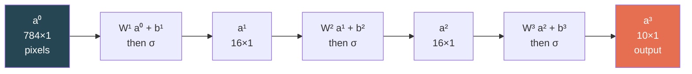

> [!tip] Why matrices?
> 
> - Much **cleaner code**.
> - Much **faster**, because libraries optimise matrix multiplication heavily.
> - New to matrix–vector multiplication? 3Blue1Brown's _Essence of Linear Algebra_ series (especially chapter 3) covers it visually.

---

## 10. Recap - the network is just a function

- A **neuron** is really a _function_: it takes in all activations of the previous layer and outputs one number between 0 and 1.
- The **entire network** is a function too:

$$ f:\ \mathbb{R}^{784} ;\longrightarrow; \mathbb{R}^{10} $$

- It takes **784 numbers** in, gives **10 numbers** out.
- It is an _absurdly complicated_ function — **13,002 parameters**, iterating many matrix–vector products and sigmoid squishifications — but it is **just a function**.

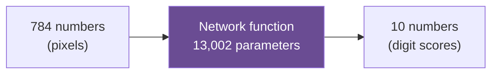

> [!success] Reassuring thought The complexity is a feature: a much simpler function would be unlikely to handle a task as hard as recognising digits.

---

## 11. Final words

- Chapter 1 gave the **structure**; the open question is **how the 13,002 numbers get learned from data** — the topic of the next chapter.
- Recommended resources from the video description:
    - 📚 Michael Nielsen's free online book _Neural Networks and Deep Learning_ (with code on the same digits example): [http://neuralnetworksanddeeplearning.com/](http://neuralnetworksanddeeplearning.com/)
    - 📝 Chris Olah's blog: [http://colah.github.io/](http://colah.github.io/)
    - 📖 _Deep Learning_ by Goodfellow, Bengio & Courville
    - 🎨 Distill: [https://distill.pub/](https://distill.pub/)
    - 🎥 Welch Labs' machine-learning series

---

## 12. ReLU vs Sigmoid

> [!warning] Verify this section against the video The timeline confirms this segment exists (at 17:03). The summary below comes from my knowledge of the video's ending — a quick re-watch is recommended.

- The **sigmoid** was the classic squishing function, partly motivated by how biological neurons are _inactive until a threshold, then active_.
- Modern networks mostly use **ReLU** (_Rectified Linear Unit_) instead, because sigmoid-based networks are **harder to train**.
- The video features a short chat with **Lisha Li** (Amplify Partners) on this.

$$ \text{ReLU}(a) = \max(0,\ a) $$

||Sigmoid|ReLU|
|---|---|---|
|Formula|$\dfrac{1}{1+e^{-x}}$|$\max(0, x)$|
|Output range|between 0 and 1|0 to +∞|
|Style|smooth squish|"off below 0, linear above 0"|
|Use today|mostly historical in hidden layers|the default in most modern nets|

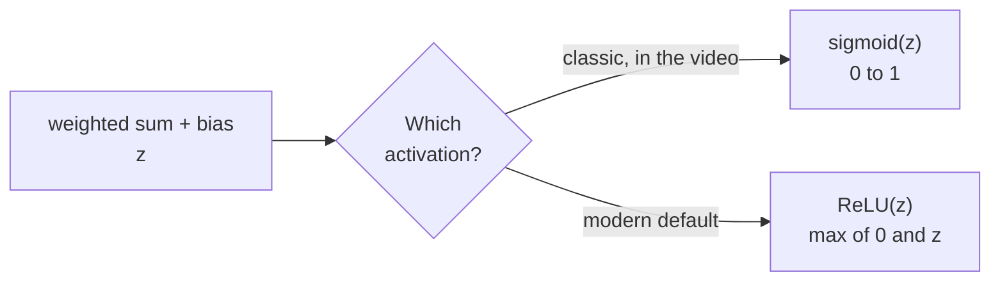

---

## 🧩 Concept map

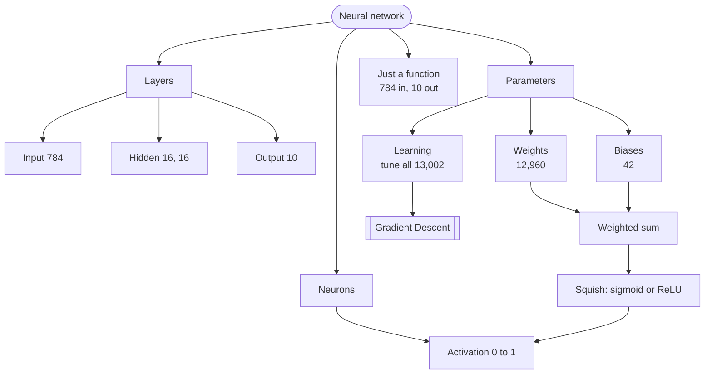

---

## 📌 Cheat sheet

|Term|Meaning|Symbol / number|
|---|---|---|
|Neuron|Holds a number 0–1|$a$|
|Activation|The neuron's number ("how lit up")|$a^{(l)}_j$|
|Input layer|One neuron per pixel|784|
|Hidden layer|Layers in between|2 × 16|
|Output layer|One neuron per digit|10|
|Weight|Strength/sign of a connection|$w_{j,k}$|
|Bias|Threshold shift before squishing|$b_j$|
|Sigmoid|Squishes any number into (0, 1)|$\sigma(x)=\frac{1}{1+e^{-x}}$|
|ReLU|$\max(0, x)$|modern default|
|Layer transition|Matrix form|$a^{(l+1)}=\sigma(W a^{(l)}+b)$|
|Total parameters|All weights + biases|13,002|

---

## 🃏 Flashcards

> Requires the _Spaced Repetition_ community plugin (tag `#flashcards` is in the properties).

What is a neuron in this video?::A thing that holds a number between 0 and 1, called its activation. How many neurons are in the input layer, and why?::784, one per pixel of the 28×28 image. How many neurons are in the output layer?::10, one per digit 0–9. What do hidden layers look like in this network?::Two hidden layers of 16 neurons each (an arbitrary choice). What do the weights of a neuron tell you?::Which pattern in the previous layer the neuron picks up on. What does the bias tell you?::How large the weighted sum must be before the neuron becomes meaningfully active. What does the sigmoid do?::Squishes any real number into the range between 0 and 1. Formula for the activations of the next layer?::$a^{(1)} = \sigma(W a^{(0)} + b)$ In the weight matrix, what does each row represent?::All connections from the previous layer into one particular neuron of the next layer. Total number of weights and biases?::13,002 (12,960 weights + 42 biases). Why does the first layer of weights hold most of the parameters?::784 × 16 = 12,544 weights, because the input layer is so wide. What does "learning" mean here?::Finding good values for all 13,002 weights and biases. What is the whole network, mathematically?::A function from 784 numbers to 10 numbers. What does ReLU stand for and compute?::Rectified Linear Unit, $\max(0, a)$.

---

## ✅ Study checklist

- [ ] Rewatch [2:42 – 8:38](https://www.youtube.com/watch?v=aircAruvnKk&t=162s) (neurons → layers → why layers)
- [ ] Redo the parameter count by hand (should reach 13,002)
- [ ] Work the toy neuron example with a different bias
- [ ] Re-derive the matrix dimensions $16\times784$, $16\times16$, $10\times16$
- [ ] Re-watch the ReLU segment at [17:03](https://www.youtube.com/watch?v=aircAruvnKk&t=1023s) and confirm section 12
- [ ] Read Michael Nielsen's book, chapter 1
- [ ] Next note: [[Gradient Descent]]

---

## 🔗 Related notes & next steps

- ⏭️ Next chapter: [[Gradient Descent]] — _how neural networks learn_
- [[Backpropagation]]
- [[Matrix Multiplication]] / Essence of Linear Algebra
- [[MNIST]] — the handwritten-digit dataset
- Other architectures to explore later: [[Convolutional Neural Networks]], [[Recurrent Neural Networks]], [[Transformers]]

%% Create the linked notes above as stubs to grow your graph view. A canvas version of the architecture is in "Neural Networks Ch1 - Architecture.canvas". %%

---

[^1]: Video: [https://www.youtube.com/watch?v=aircAruvnKk](https://www.youtube.com/watch?v=aircAruvnKk) (3Blue1Brown, Oct 5, 2017). Written adaptation of the same chapter: [https://www.3blue1brown.com/lessons/neural-networks/](https://www.3blue1brown.com/lessons/neural-networks/) [^2]: The bird-vs-airplane comparison is from the written adaptation of this chapter.