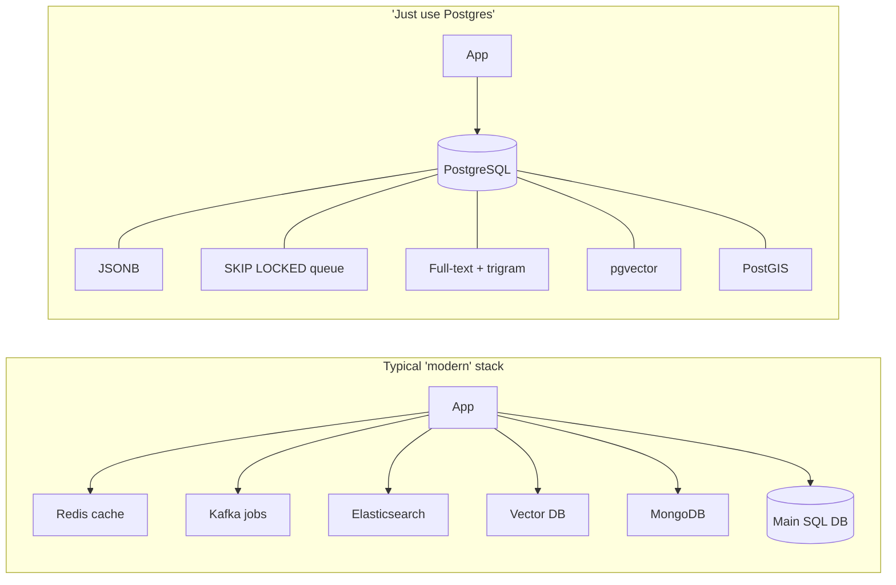
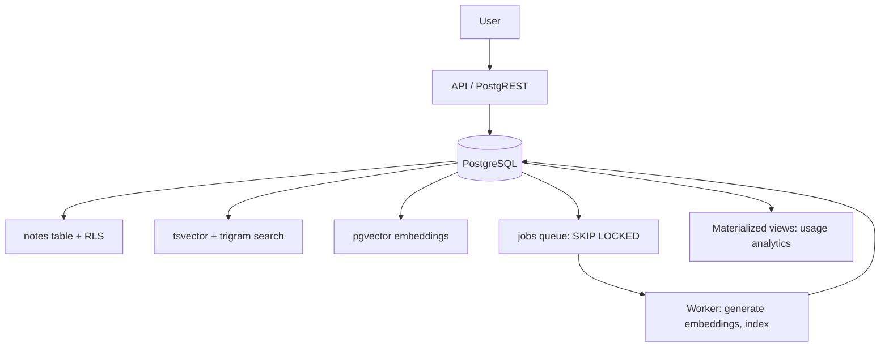

## Table of Contents

- [[#0. Transcript glossary and fact-check]]
- [[#1. Foundations]]
- [[#2. Core database concepts]]
- [[#3. Replacing parts of your stack]]
- [[#4. Postgres vs MySQL (practical differences with examples)]]
- [[#5. Learning roadmap and capstone]]
- [[#6. Where Postgres is enough (and where it isn't)]]
- [[#7. Cheat sheet]]

---

## 0. Transcript glossary and fact-check

The transcript is auto-generated, so many terms are misspelled. Decoder:

| Transcript says         | Actually means                                  |
| ----------------------- | ----------------------------------------------- |
| Postgress / Postcrestql | PostgreSQL / Postgres                           |
| Reddus                  | Redis (in-memory cache / key-value store)       |
| CFKA                    | Kafka (distributed event log / streaming)       |
| Rabbit MQ               | RabbitMQ (message broker)                       |
| elastic search          | Elasticsearch (search and log analytics engine) |
| SAS startups            | SaaS (software as a service)                    |
| asset compliant         | ACID compliant                                  |
| four update skip locked | `FOR UPDATE SKIP LOCKED`                        |
| triagram / pg triagram  | trigram / `pg_trgm`                             |
| post REST               | PostgREST                                       |
| gist                    | GiST (Generalized Search Tree)                  |
| brin                    | BRIN (Block Range Index)                        |
| TS vector / TS query    | `tsvector` / `tsquery`                          |

> [!warning] Claims in the video that need nuance
> 
> - **"Cryptographic policies" in RLS**: RLS policies are plain SQL predicates (e.g. `user_id = current_user_id()`), not cryptography. The _identity_ usually comes from a signed token (JWT) that the API layer verifies.
> - **"Undisputed gold standard" for PostGIS**: PostGIS is the most capable open-source spatial engine, but "undisputed" is marketing language. Commercial GIS and specialized routing engines still exist.
> - **"Replaces everything"**: it is a _starting default_, not a law. See [[#6. Where Postgres is enough (and where it isn't)]].
> - **Sponsor segments** (Neon, CodeCrafters) are ads. Neon is a managed serverless Postgres; the concepts below work on any Postgres.

---

## 1. Foundations

Before any advanced feature, you need:

- Tables, rows, columns, primary and foreign keys
- SQL basics: `SELECT`, `JOIN`, `GROUP BY`, `ORDER BY`, subqueries
- Index basics: why scanning every row is slow
- Transactions: several statements treated as one unit of work

### Mental model

|Piece|Role|
|---|---|
|**Tables**|store facts|
|**Indexes**|help you find facts fast|
|**Transactions**|keep facts correct|
|**Extensions**|teach Postgres new tricks|

> [!tip] Why "boring tech" wins Every extra system (Redis, Kafka, Elasticsearch...) adds: a bill, a deploy target, monitoring, backups, security surface, and a **data sync problem** (keeping it consistent with your main DB). Postgres removes the sync problem because everything lives in one transactional place.

### Before the stack: the "subscription simulator" problem



---

## 2. Core database concepts

### 2.1 ACID

ACID means your data changes behave safely.

|Letter|Meaning|Plain-English example|
|---|---|---|
|**A**tomicity|All steps happen or none do|Transfer: debit and credit both happen or neither|
|**C**onsistency|Rules stay valid before and after|Balance can never go negative (CHECK constraint)|
|**I**solation|Concurrent users don't corrupt each other|Two people booking the same seat don't both succeed|
|**D**urability|Committed data survives crashes|Server dies after COMMIT, data is still there|

Durability in Postgres comes from the **WAL (Write-Ahead Log)**: changes are written to a sequential log and flushed to disk _before_ the transaction is reported as committed. After a crash, Postgres replays the WAL.

```sql
CREATE TABLE accounts (
  id      serial PRIMARY KEY,
  owner   text NOT NULL,
  balance numeric(12,2) NOT NULL CHECK (balance >= 0)
);

BEGIN;
UPDATE accounts SET balance = balance - 100 WHERE id = 1;
UPDATE accounts SET balance = balance + 100 WHERE id = 2;
COMMIT;   -- or ROLLBACK; to undo everything
```

> [!example] Mini-project 1: Wallet transfer system
> 
> 1. Create `users`/`accounts` and `transactions` (ledger) tables.
> 2. Transfer money from A to B inside one transaction.
> 3. Simulate an error midway (e.g. debit more than the balance, so the CHECK fails) and verify nothing changed.
> 4. Record each transfer in the ledger table in the **same** transaction.
> 
> **You should learn:** why `BEGIN/COMMIT/ROLLBACK` matter; why multi-query business logic should be transactional; why a database is a _correctness engine_, not just storage.

### 2.2 MVCC (Multi-Version Concurrency Control)

Instead of overwriting a row in place, Postgres keeps **multiple versions** of a row. Each transaction sees a consistent _snapshot_.

- Readers don't block writers; writers don't block readers.
- An `UPDATE` actually creates a **new row version** and marks the old one dead.
- Dead versions are cleaned up by **VACUUM** (autovacuum does this in the background).

```sql
-- Peek at the hidden version columns
SELECT xmin, xmax, ctid, * FROM accounts;
```

- `xmin` = transaction ID that created this version
- `xmax` = transaction ID that deleted/updated it (0 if live)
- `ctid` = physical location (page, offset)

> [!note] Side effects of MVCC you should know
> 
> - **Bloat**: lots of updates leave dead tuples; tune autovacuum.
> - **Long-running transactions** prevent VACUUM from cleaning old versions.
> - **HOT updates** (heap-only tuples) avoid index changes when you update non-indexed columns, which is one reason fewer indexes means faster writes.

### 2.3 Locks, deadlocks, isolation levels

|Isolation level|What you see|Notes|
|---|---|---|
|**Read Committed** (Postgres default)|Each _statement_ sees data committed before it started|Can get non-repeatable reads|
|**Repeatable Read**|Whole transaction sees one snapshot|Postgres' version is snapshot isolation; can raise serialization errors|
|**Serializable**|Behaves as if transactions ran one at a time|Use with retry logic|

**Deadlock example**

```
Session A: UPDATE accounts ... WHERE id=1;   -- locks row 1
Session B: UPDATE accounts ... WHERE id=2;   -- locks row 2
Session A: UPDATE accounts ... WHERE id=2;   -- waits for B
Session B: UPDATE accounts ... WHERE id=1;   -- waits for A  -> DEADLOCK
```

Postgres detects this and aborts one transaction. **Fix:** always lock rows in a consistent order (e.g. by `id`).

**Concurrent vs parallel:** _concurrent_ = many tasks in progress, interleaved; _parallel_ = literally executing at the same instant on multiple cores.

> [!example] Mini-project 2: Concurrent seat booking
> 
> 1. Table `seats(id, event_id, booked_by, status)`.
> 2. Open **two psql sessions**. In A, `BEGIN; UPDATE seats SET ... WHERE id=1;` (don't commit). In B, read or update the same row and observe.
> 3. Reproduce a **race condition** (two users both "see" seat free, both book).
> 4. Fix it with `SELECT ... FOR UPDATE` or a unique constraint.
> 5. Repeat under `REPEATABLE READ` and `SERIALIZABLE`.

### 2.4 Indexes

An index is a data structure that lets Postgres **avoid scanning the whole table**.

> [!quote] Real truth It's not "indexes make queries fast." It's "the **right index** makes a **specific access pattern** fast."

|Index type|Best for|Used in this note for|
|---|---|---|
|**B-tree** (default)|equality, ranges, sorting|primary keys, timestamps, most columns|
|**GIN** (Generalized Inverted Index)|"contains" lookups: JSONB, arrays, full-text|JSONB, `tsvector`, trigram|
|**GiST** (Generalized Search Tree)|geometry, ranges, nearest-neighbor, some similarity|PostGIS|
|**BRIN** (Block Range Index)|huge, naturally ordered data (time-based logs)|event logs|
|**HNSW / IVFFlat** (pgvector)|approximate nearest-neighbor vector search|embeddings|
|**Hash**|equality only|rarely needed|

**Inverted index analogy:** the index at the back of a textbook. Instead of scanning every page for a word, you look up the word and get the list of pages (here: row IDs).

```sql
-- 1M-row playground
CREATE TABLE orders AS
SELECT g AS id,
       (random()*100000)::int AS customer_id,
       now() - (random()*365 || ' days')::interval AS created_at
FROM generate_series(1, 1000000) g;

EXPLAIN ANALYZE SELECT * FROM orders WHERE customer_id = 42;   -- Seq Scan

CREATE INDEX idx_orders_customer ON orders (customer_id);
ANALYZE orders;
EXPLAIN ANALYZE SELECT * FROM orders WHERE customer_id = 42;   -- Index Scan / Bitmap Scan
```

> [!example] Mini-project 3: Index lab
> 
> 1. Build the 1M-row table above.
> 2. Query with no index, then with a B-tree. Compare `EXPLAIN ANALYZE` output.
> 3. Try a **composite index** `(customer_id, created_at)` and test queries that use only the 2nd column (spoiler: it won't help much).
> 4. Measure insert speed with 0, 3, and 8 indexes.
> 
> **You should learn:** sequential vs index scan, **selectivity** (an index on a column with 2 distinct values is nearly useless), and why too many indexes hurt writes.

---

## 3. Replacing parts of your stack

### 3.1 JSONB: replaces MongoDB-style storage

**JSONB** stores JSON in a **decomposed binary format** at insert time (the "B" = binary). Unlike plain `json` (stored as text and re-parsed on each query), `jsonb` is fast to query, supports indexing, and removes duplicate keys.

A **GIN index** on a JSONB column maps each key/value to the rows that contain it, so nested lookups don't scan the table. And since it's still SQL, you can **join documents with relational tables in one ACID transaction**.

```sql
CREATE TABLE products (
  id          bigserial PRIMARY KEY,
  name        text NOT NULL,
  price       numeric(10,2) NOT NULL,
  category_id int NOT NULL,
  attrs       jsonb NOT NULL DEFAULT '{}'
);

INSERT INTO products (name, price, category_id, attrs) VALUES
 ('Laptop X', 999, 1, '{"ram": 16, "screen_size": 14, "color": "grey"}'),
 ('Desk Y',   250, 2, '{"material": "oak", "color": "brown"}');

CREATE INDEX idx_products_attrs ON products USING gin (attrs jsonb_path_ops);

-- Containment query, uses the GIN index
SELECT name FROM products WHERE attrs @> '{"ram": 16}';

-- Extract a value
SELECT name, attrs->>'color' AS color FROM products;

-- Expression index for one hot key
CREATE INDEX idx_products_color ON products ((attrs->>'color'));
```

> [!tip] When to use JSONB vs real columns **Use JSONB when** structure varies per record (product attributes, settings, event payloads), you still want joins/transactions, and you need to query inside the JSON. **Don't use JSONB for everything:** if a field is queried often and has a stable shape, make it a **real column** (typed, constrained, cheaper). If relationships matter, **normalize**.

Learn first: normalization vs denormalization; when schema flexibility helps; why JSON-in-SQL isn't abandoning relational modeling.

> [!example] Mini-project 4: Product catalog Common fields (`id, name, price, category_id`) as normal columns; flexible attributes (`ram, screen_size, material, color`) in JSONB. Add a GIN index and query nested properties. Compare `jsonb_ops` vs `jsonb_path_ops` index size and supported operators.

### 3.2 Queues with `FOR UPDATE SKIP LOCKED`: replaces RabbitMQ / basic Kafka / Redis queues

A queue is just **pending work + workers that claim work safely**. The hard part: two workers must never grab the same job.

**Naive approach:** `SELECT ... FOR UPDATE` makes worker 2 _wait_ behind worker 1's lock (serialized, slow). **`SKIP LOCKED`:** "grab the first row that isn't already locked; if a row is locked, skip it and take the next." Workers never block each other.

```sql
CREATE TABLE jobs (
  id           bigserial PRIMARY KEY,
  type         text NOT NULL,
  payload      jsonb NOT NULL,
  status       text NOT NULL DEFAULT 'pending',   -- pending | processing | done | failed
  attempts     int  NOT NULL DEFAULT 0,
  scheduled_at timestamptz NOT NULL DEFAULT now()
);
CREATE INDEX idx_jobs_pending ON jobs (scheduled_at) WHERE status = 'pending';  -- partial index

-- Worker claim query (atomic)
WITH next_job AS (
  SELECT id FROM jobs
  WHERE status = 'pending' AND scheduled_at <= now()
  ORDER BY scheduled_at
  FOR UPDATE SKIP LOCKED
  LIMIT 1
)
UPDATE jobs j
SET status = 'processing', attempts = attempts + 1
FROM next_job
WHERE j.id = next_job.id
RETURNING j.*;
```

Worker loop (pseudocode):

```
loop:
  job = claim()                # query above
  if none: sleep; continue
  try: do_work(job); UPDATE jobs SET status='done' WHERE id=job.id
  except: UPDATE jobs SET status = CASE WHEN attempts >= 5 THEN 'failed' ELSE 'pending' END,
                          scheduled_at = now() + backoff(attempts)
          WHERE id=job.id
```

> [!example] Mini-project 5: Email job processor Table `jobs(id, type, payload, status, attempts, scheduled_at)`. Insert pending jobs, run **2-3 workers concurrently**, claim with SKIP LOCKED, process, mark success/failure. Add retries with exponential backoff and a "dead letter" status. **You'll understand:** row locking, **idempotency** (a job may run twice after a crash, so make handlers safe to repeat), retry logic, **poison jobs** (jobs that always fail), **visibility timeout** (re-queue jobs stuck in `processing` too long).

> [!note] Bonus `LISTEN/NOTIFY` lets workers wake instantly when a job is inserted, instead of polling. Libraries like pgmq, Graphile Worker, and River wrap these patterns.

### 3.3 Full-text search and fuzzy search: replaces Elasticsearch (for app search bars)

Elasticsearch shines for globally distributed log analytics and huge search clusters. For "a search bar in my app," Postgres is usually enough.

**Key tools**

- `tsvector`: indexed, normalized text representation (stop words removed, **stemmed**: "running" becomes "run")
- `tsquery`: the parsed search query
- `ts_rank`: relevance ranking
- `pg_trgm`: **trigram** similarity for typo tolerance

**Trigrams:** break a word into 3-letter chunks. "postgres" gives roughly `pos, ost, stg, tgr, gre, res`. A typo like "postgress" still shares most trigrams, so similarity is high.

```sql
CREATE TABLE notes (
  id    bigserial PRIMARY KEY,
  title text NOT NULL,
  body  text NOT NULL,
  tsv   tsvector GENERATED ALWAYS AS (
          setweight(to_tsvector('english', title), 'A') ||
          setweight(to_tsvector('english', body),  'B')
        ) STORED
);
CREATE INDEX idx_notes_tsv ON notes USING gin (tsv);

-- Stemmed search: "run" finds "running"
SELECT id, title, ts_rank(tsv, q) AS rank
FROM notes, websearch_to_tsquery('english', 'run') AS q
WHERE tsv @@ q
ORDER BY rank DESC
LIMIT 10;

-- Typo tolerance
CREATE EXTENSION IF NOT EXISTS pg_trgm;
CREATE INDEX idx_notes_title_trgm ON notes USING gin (title gin_trgm_ops);

SELECT title, similarity(title, 'postgress') AS sim
FROM notes
WHERE title % 'postgress'
ORDER BY sim DESC;
```

> [!example] Mini-project 6: Notes app with search
> 
> - Searching "run" finds "running".
> - "postgress" still finds "postgres".
> - Add ranking (title matches outrank body matches) and highlighted snippets with `ts_headline`. **Learn along the way:** stemming, stop words, ranking, and why `LIKE '%word%'` doesn't scale (a leading wildcard can't use a B-tree, so it scans the whole table; trigram GIN fixes this).

> [!warning] Limits vs Elasticsearch Weaker relevance tuning, fewer language analyzers/synonym tooling, no built-in distributed sharding for huge corpora. If search _is_ your product, reconsider.

### 3.4 pgvector: replaces a separate vector DB (Pinecone etc.)

A **vector (embedding)** is a list of numbers representing semantic meaning, produced by an embedding model. Similar meaning leads to nearby vectors.

**The hybrid search problem:** real apps want "semantically similar **AND** authored by user 42 **AND** last week." With a separate vector DB, you query two systems and cross-reference over the network (slow, inconsistent). In Postgres it's one query.

**Distance metrics (basic):**

- **Cosine distance** (`<=>`): angle between vectors; most common for text embeddings
- **Euclidean / L2** (`<->`): straight-line distance
- **Inner product** (`<#>`): used with normalized vectors

**Exact vs approximate nearest neighbor (ANN):** exact = compare against every vector (accurate, slow at scale). ANN = trade a little accuracy for big speed.

**HNSW (Hierarchical Navigable Small World):** a graph index built as multiple layers, like a high-dimensional skip list. Search starts at a sparse top layer with long-range links, then descends to denser layers to refine, so it examines only a tiny fraction of vectors.

```sql
CREATE EXTENSION IF NOT EXISTS vector;

CREATE TABLE docs (
  id         bigserial PRIMARY KEY,
  title      text NOT NULL,
  body       text NOT NULL,
  author_id  int  NOT NULL,
  created_at timestamptz NOT NULL DEFAULT now(),
  embedding  vector(1536)         -- dimension must match your embedding model
);

CREATE INDEX idx_docs_embedding ON docs USING hnsw (embedding vector_cosine_ops);

-- Semantic + relational filters in ONE query ($1 = query embedding)
SELECT id, title, embedding <=> $1 AS distance
FROM docs
WHERE author_id = 42
  AND created_at > now() - interval '7 days'
ORDER BY embedding <=> $1
LIMIT 5;
```

> [!warning] Filtering and ANN indexes With approximate indexes, a restrictive `WHERE` filter can reduce recall (the index returns top-N, then filters, and you may get fewer results). Newer pgvector versions offer iterative index scans, and partitioning or partial indexes help for per-tenant filters. Always test recall on your data.

> [!example] Mini-project 7: Semantic FAQ search Generate embeddings externally (any embedding API/model), store them in `docs`, query top-k similar docs filtered by author/date. Compare exact scan vs HNSW in speed and result overlap (recall).

### 3.5 PostGIS: replaces specialized GIS systems

PostGIS adds spatial types and hundreds of functions: radius search, polygons, geofencing, "find nearby."

**Why GiST:** doing precise geometry math on every row would be crushing. A GiST index (an R-tree-like structure) groups shapes into **overlapping bounding boxes**. Query flow: (1) cheap bounding-box check discards millions of rows, (2) exact math runs only on the handful of survivors.

**Needed concepts**

- **Coordinate systems (SRID):** 4326 = WGS 84 (lat/lon on the globe, GPS standard)
- **geometry** (flat plane math, fast, units in degrees for 4326) vs **geography** (spherical math, meters, more accurate for real distances)
- **Order matters:** PostGIS points are `(longitude, latitude)`, i.e. **x, y**, not lat/lon.

```sql
CREATE EXTENSION IF NOT EXISTS postgis;

CREATE TABLE shops (
  id   serial PRIMARY KEY,
  name text NOT NULL,
  geog geography(Point, 4326) NOT NULL
);
CREATE INDEX idx_shops_geog ON shops USING gist (geog);

INSERT INTO shops (name, geog)
VALUES ('Bean Bar', ST_SetSRID(ST_MakePoint(:lon, :lat), 4326)::geography);

-- All shops within 2 km of the user
SELECT name,
       ST_Distance(geog, user_pt) AS meters
FROM shops,
     (SELECT ST_SetSRID(ST_MakePoint(:user_lon, :user_lat), 4326)::geography AS user_pt) u
WHERE ST_DWithin(geog, user_pt, 2000)
ORDER BY meters;

-- Inside a delivery zone polygon
SELECT s.name FROM shops s
JOIN delivery_zones z ON ST_Intersects(s.geog, z.area);
```

> [!example] Mini-project 8: Nearby coffee-shop finder Store points, query within 2 km, then add a polygon "delivery zone" check. Compare `EXPLAIN ANALYZE` with and without the GiST index.

### 3.6 Partitioning + BRIN: replaces time-series DBs (for moderate volume)

One giant event table becomes painful (slow vacuum, huge indexes, painful deletes).

- **Declarative partitioning** splits a table into physical chunks (daily/monthly). Queries with a time filter hit only the relevant partitions (**partition pruning**). Dropping old data = `DROP TABLE old_partition` (instant) instead of a giant `DELETE`.
- **BRIN** stores only **min/max values per block range** (e.g. per 128 pages). For naturally ordered data (append-only timestamps), it's tiny compared to a B-tree and lets Postgres skip huge swaths of disk.

> [!warning] BRIN only works when physical order correlates with the column If rows are inserted out of time order, BRIN's min/max ranges overlap and it skips little. Check correlation: `SELECT correlation FROM pg_stats WHERE tablename='events' AND attname='created_at';` (close to 1 is good).

```sql
CREATE TABLE events (
  id         bigint GENERATED ALWAYS AS IDENTITY,
  created_at timestamptz NOT NULL,
  kind       text NOT NULL,
  payload    jsonb
) PARTITION BY RANGE (created_at);

CREATE TABLE events_2026_10 PARTITION OF events
  FOR VALUES FROM ('2026-10-01') TO ('2026-11-01');
CREATE TABLE events_2026_11 PARTITION OF events
  FOR VALUES FROM ('2026-11-01') TO ('2026-12-01');

CREATE INDEX ON events_2026_10 USING brin (created_at);
CREATE INDEX ON events_2026_11 USING brin (created_at);

-- Retention: drop a month instantly
DROP TABLE events_2026_10;
```

> [!note] Gotcha A primary key/unique constraint on a partitioned table must **include the partition key** (e.g. `PRIMARY KEY (id, created_at)`). Tools like `pg_partman` automate creating and dropping partitions.

> [!example] Mini-project 9: Event log system Partition logs by month, add BRIN on timestamp, insert a few million rows, query one time window, and compare timing, plan, and index size against a single table with a B-tree. **Teaches:** data lifecycle management, pruning old partitions, why time-series workloads have special storage patterns.

### 3.7 Materialized views: replaces a data warehouse (for modest analytics)

||Normal view|Materialized view|
|---|---|---|
|Stores data?|No, saved query|**Yes**, physical result on disk|
|Cost per read|Re-runs the full query|Cheap read|
|Freshness|Always fresh|Stale until refreshed|

`REFRESH MATERIALIZED VIEW CONCURRENTLY` rebuilds in the background, diffs against the old data, and swaps changes in **without blocking readers**. It requires a **unique index** on the view.

```sql
CREATE MATERIALIZED VIEW daily_revenue AS
SELECT date_trunc('day', created_at) AS day,
       sum(total)                    AS revenue,
       count(DISTINCT customer_id)   AS active_customers
FROM orders
GROUP BY 1;

CREATE UNIQUE INDEX ON daily_revenue (day);   -- required for CONCURRENTLY

REFRESH MATERIALIZED VIEW CONCURRENTLY daily_revenue;   -- run via cron / pg_cron
```

Learn along the way: aggregation, precomputation, **freshness vs latency tradeoff**, and why **OLTP** (many small transactions) and **OLAP** (few huge scans) stress databases differently. Postgres isn't a columnar warehouse; at billions of rows with heavy ad-hoc analytics, ClickHouse/BigQuery/Snowflake earn their keep.

> [!example] Mini-project 10: Sales dashboard backend Raw tables `orders, customers, products`. Build materialized views for daily revenue, top products, active customers. Refresh with `pg_cron` every 5 minutes. Measure dashboard query time vs the raw aggregation.

### 3.8 Row-Level Security and auto-generated APIs: replaces boilerplate middleware

**PostgREST** and **pg_graphql** read your schema and generate a REST/GraphQL API automatically, so you don't hand-write a controller per table. Security is then enforced **in the database** with **Row-Level Security (RLS)**.

```sql
CREATE TABLE tasks (
  id      bigserial PRIMARY KEY,
  user_id uuid NOT NULL,
  title   text NOT NULL,
  done    boolean NOT NULL DEFAULT false
);

ALTER TABLE tasks ENABLE ROW LEVEL SECURITY;
-- ALTER TABLE tasks FORCE ROW LEVEL SECURITY;   -- also applies to the table owner

CREATE POLICY own_tasks ON tasks
  USING      (user_id = current_setting('app.user_id')::uuid)   -- which rows are visible
  WITH CHECK (user_id = current_setting('app.user_id')::uuid);  -- which rows can be written

-- Per request (your API layer / PostgREST sets this from the verified JWT):
SET LOCAL app.user_id = '3f0e...';
SELECT * FROM tasks;   -- only this user's rows, even if the app forgot a WHERE clause
```

> [!warning] RLS pitfalls
> 
> - **Superusers and table owners bypass RLS** by default. Your app must connect as a **non-owner, least-privilege role**.
> - Policies add overhead; index the columns they filter on (`user_id`).
> - RLS covers row access, not everything (column-level privileges, rate limiting, business rules still need handling).

Needed topics: **authentication** (who are you?) vs **authorization** (what can you do?), policies, **principle of least privilege**, and why "security only in app code" is fragile (one forgotten `WHERE` leaks everyone's data).

> [!example] Mini-project 11: Multi-user task manager Each user sees only their own tasks. Implement RLS so a **deliberately buggy query** (`SELECT * FROM tasks`) cannot leak other users' rows. Then add PostgREST in front and test with two different JWTs.

---

## 4. Postgres vs MySQL (practical differences with examples)

> [!info] Scope and versions Comparison assumes **PostgreSQL 15+** and **MySQL 8.x with InnoDB** (the default engine). MySQL has been improving (8.0, 8.4 LTS, 9.x), so check the docs for your exact version before relying on a detail. MariaDB differs from MySQL in several places below (e.g. it supports `RETURNING`).

### 4.0 Quick comparison table

| Area                         | PostgreSQL                                           | MySQL (InnoDB)                                                |
| ---------------------------- | ---------------------------------------------------- | ------------------------------------------------------------- |
| Table storage                | Heap table; indexes point to physical row location   | **Clustered** on primary key; row data lives in the PK B-tree |
| MVCC old versions            | Stored **in the table** (dead tuples; VACUUM cleans) | Stored in **undo logs** (purge cleans)                        |
| Default isolation            | Read Committed                                       | **Repeatable Read** (with gap/next-key locks)                 |
| DDL in transactions          | **Yes** (transactional DDL)                          | No, DDL implicitly commits                                    |
| `RETURNING`                  | Yes                                                  | No (MariaDB yes)                                              |
| Upsert                       | `ON CONFLICT`                                        | `ON DUPLICATE KEY UPDATE`                                     |
| Arrays, ranges, custom types | Native                                               | Not native                                                    |
| JSON                         | `jsonb` + GIN, rich operators                        | `JSON` + generated-column or multi-valued indexes             |
| Partial indexes              | Yes                                                  | No (workarounds)                                              |
| Materialized views           | Yes                                                  | No (emulate with tables)                                      |
| Row-Level Security           | Yes                                                  | No                                                            |
| Extensions                   | Huge ecosystem (PostGIS, pgvector, pg_trgm...)       | Plugins, much smaller ecosystem                               |
| String comparison default    | Case-**sensitive**                                   | Case-**insensitive** (default collations)                     |
| Connections                  | Process per connection (use PgBouncer)               | Thread per connection (lighter)                               |
| Identifier quoting           | `"double quotes"`                                    | `` `backticks` ``                                             |

### 4.1 Transactional DDL

Postgres lets you roll back schema changes along with data. MySQL commits implicitly when you run DDL.

```sql
-- PostgreSQL
BEGIN;
ALTER TABLE users ADD COLUMN age int;
INSERT INTO users (name, age) VALUES ('A', 30);
ROLLBACK;     -- column AND row both gone. Migration is all-or-nothing.
```

```sql
-- MySQL
START TRANSACTION;
INSERT INTO users (name) VALUES ('A');
ALTER TABLE users ADD COLUMN age INT;   -- implicit COMMIT happens here
ROLLBACK;                               -- too late: the INSERT is already committed
```

**Why it matters:** a migration that fails halfway in MySQL can leave your schema half-applied. In Postgres, it rolls back cleanly.

### 4.2 `RETURNING` vs `LAST_INSERT_ID()`

```sql
-- PostgreSQL: get generated values back in the same statement
INSERT INTO users (name) VALUES ('Alice') RETURNING id, created_at;
UPDATE accounts SET balance = balance - 50 WHERE id = 1 RETURNING balance;
DELETE FROM jobs WHERE status = 'done' RETURNING id;
```

```sql
-- MySQL
INSERT INTO users (name) VALUES ('Alice');
SELECT LAST_INSERT_ID();     -- only the last auto-increment id, per connection
-- For UPDATE/DELETE you need a second SELECT.
```

This is also why the queue claim query in [[#3.2 Queues with `FOR UPDATE SKIP LOCKED` replaces RabbitMQ / basic Kafka / Redis queues]] is so neat in Postgres: claim and fetch in one atomic statement.

### 4.3 Upsert syntax

```sql
-- PostgreSQL
INSERT INTO page_views (page, views) VALUES ('/home', 1)
ON CONFLICT (page) DO UPDATE SET views = page_views.views + 1;
```

```sql
-- MySQL
INSERT INTO page_views (page, views) VALUES ('/home', 1)
ON DUPLICATE KEY UPDATE views = views + 1;
```

Postgres' `ON CONFLICT` lets you name _which_ constraint conflicts and supports `DO NOTHING`; MySQL reacts to **any** unique-key violation.

### 4.4 Case sensitivity and quoting

```sql
INSERT INTO users (name) VALUES ('Alice');

SELECT * FROM users WHERE name = 'alice';
-- PostgreSQL: 0 rows  (case-sensitive; use ILIKE or lower())
-- MySQL:      1 row   (default collation like utf8mb4_0900_ai_ci is case- and accent-insensitive)
```

Postgres: `WHERE name ILIKE 'alice'` or a functional index `CREATE INDEX ON users (lower(name));`. Unquoted identifiers are **folded to lowercase** in Postgres (`CREATE TABLE Users` becomes `users`); a quoted `"Users"` is a different, case-sensitive name. Avoid quoted mixed-case names.

### 4.5 Strictness and "silent surprises"

Postgres is famously strict. Older/lenient MySQL modes silently coerced data; modern MySQL defaults to strict mode but still has quirks.

```sql
-- PostgreSQL
SELECT 'abc'::int;                          -- ERROR: invalid input syntax for type integer
INSERT INTO t (name) VALUES (repeat('x',500)); -- ERROR if name is varchar(255)

SELECT customer_id, name, count(*) FROM orders GROUP BY customer_id;
-- ERROR: "name" must appear in GROUP BY or be used in an aggregate
```

```sql
-- MySQL (e.g. non-strict sql_mode)
INSERT INTO t (name) VALUES (REPEAT('x',500));  -- silently truncated to 255 chars + warning
SELECT 0 = 'abc';                                -- 1 (string coerced to 0)
```

Check your `sql_mode` (`ONLY_FULL_GROUP_BY`, `STRICT_TRANS_TABLES`) to get Postgres-like behavior in MySQL.

### 4.6 Isolation defaults and gap locks (real concurrency consequence)

MySQL's default **Repeatable Read** uses **gap/next-key locks** to prevent phantoms, which can block inserts unexpectedly:

```sql
-- MySQL, Session A
START TRANSACTION;
SELECT * FROM seats WHERE id BETWEEN 10 AND 20 FOR UPDATE;   -- locks the range, including gaps

-- Session B
INSERT INTO seats (id, ...) VALUES (15, ...);   -- BLOCKS, even if no row 15 exists
```

In Postgres, Read Committed `FOR UPDATE` locks **only existing matching rows**; concurrent inserts into the range proceed. Postgres instead needs explicit constraints or `SERIALIZABLE` for phantom protection.

Consequence: MySQL apps hit **gap-lock deadlocks** more often under concurrent inserts; Postgres apps hit **serialization failures** that require retry when using higher isolation levels.

### 4.7 How updates work internally (the famous write-amplification debate)

```sql
UPDATE users SET last_login = now() WHERE id = 1;
```

- **Postgres:** writes a **new row version** into the heap. If _any_ indexed column changed (or no free space on the page), **every index** gets a new entry too. HOT updates avoid this when no indexed column changes and the page has room. Old versions are cleaned by VACUUM (bloat risk).
- **MySQL/InnoDB:** updates the row **in place** in the clustered index and writes the old version to the **undo log**. Secondary indexes store the **primary key** (not a physical address), so unrelated-column updates don't touch them.

**Trade-offs**

- MySQL's design can be cheaper for update-heavy workloads with many secondary indexes; this was a core argument in Uber's well-known 2016 engineering post about moving from Postgres to MySQL (Postgres has improved since, e.g. HOT improvements and better replication).
- Postgres' design makes **long-running reads cheap** and rollbacks instant (just mark the version dead), but needs **autovacuum tuning**.
- In MySQL, lookups by **primary key** are very fast (data is in the PK tree); secondary-index lookups require a second hop into the PK tree. A large/random PK (like a random UUID) hurts insert locality in MySQL.

### 4.8 Data types Postgres has and MySQL doesn't (natively)

**Arrays**

```sql
-- PostgreSQL
CREATE TABLE posts (id serial PRIMARY KEY, tags text[]);
INSERT INTO posts (tags) VALUES (ARRAY['db','sql']);
SELECT * FROM posts WHERE tags @> ARRAY['sql'];
CREATE INDEX ON posts USING gin (tags);
```

```sql
-- MySQL: use a join table, or JSON array + multi-valued index
CREATE TABLE post_tags (post_id INT, tag VARCHAR(50), PRIMARY KEY (post_id, tag));
```

**Range types + exclusion constraints** (impossible to express directly in MySQL):

```sql
-- PostgreSQL: no two bookings for the same room may overlap, enforced by the DB
CREATE EXTENSION btree_gist;
CREATE TABLE bookings (
  room_id int,
  during  tstzrange,
  EXCLUDE USING gist (room_id WITH =, during WITH &&)
);
INSERT INTO bookings VALUES (1, '[2026-10-10 10:00, 2026-10-10 12:00)');
INSERT INTO bookings VALUES (1, '[2026-10-10 11:00, 2026-10-10 13:00)');
-- ERROR: conflicting key value violates exclusion constraint
```

In MySQL you'd enforce this in application code or with locking, which is race-prone.

**Others:** `uuid`, `inet/cidr`, `enum` and **composite/domain types**, `money`/`numeric`, `tsvector`, `hstore`, geometric types. MySQL has `ENUM` and `SET`, but no composite types, domains, or true array types.

### 4.9 JSON: both support it, the ergonomics differ

```sql
-- PostgreSQL: index the whole document, query with containment
CREATE INDEX ON products USING gin (attrs jsonb_path_ops);
SELECT * FROM products WHERE attrs @> '{"color":"red","ram":16}';
```

```sql
-- MySQL: JSON type is binary too, but indexing is via generated columns
ALTER TABLE products
  ADD COLUMN color VARCHAR(30) GENERATED ALWAYS AS (attrs->>'$.color') STORED,
  ADD INDEX idx_color (color);
SELECT * FROM products WHERE attrs->>'$.color' = 'red';
-- MySQL 8.0.17+ also supports multi-valued indexes for JSON arrays.
```

Postgres lets you index _arbitrary_ keys inside documents with one GIN index; in MySQL you typically decide in advance which paths to index.

### 4.10 Partial and expression indexes

```sql
-- PostgreSQL: unique email only among non-deleted users (soft delete)
CREATE UNIQUE INDEX uq_users_email_active ON users (email) WHERE deleted_at IS NULL;

-- Index only hot rows (tiny index)
CREATE INDEX idx_jobs_pending ON jobs (scheduled_at) WHERE status = 'pending';
```

```sql
-- MySQL: no partial indexes. Common workaround: generated column + unique index
ALTER TABLE users
  ADD COLUMN active_email VARCHAR(255)
    GENERATED ALWAYS AS (IF(deleted_at IS NULL, email, NULL)) STORED,
  ADD UNIQUE KEY uq_active_email (active_email);   -- NULLs don't collide
```

MySQL 8.0.13+ supports functional (expression) indexes, so `lower(name)` indexing works, but not `WHERE`-filtered ones.

### 4.11 Search, vectors, spatial

|Need|PostgreSQL|MySQL|
|---|---|---|
|Full-text|`tsvector`, GIN, stemming dictionaries, ranking, `websearch_to_tsquery`|`FULLTEXT` index with `MATCH ... AGAINST` (simpler, fewer language features)|
|Typo tolerance|`pg_trgm`|No built-in equivalent|
|Vector search|`pgvector` (HNSW/IVFFlat) mature and widely hosted|`VECTOR` type introduced in 9.x, but advanced vector indexing is tied to specific editions/services; verify for your setup|
|Spatial|**PostGIS** (geography, raster, topology, routing add-ons)|Built-in spatial types and R-tree indexes; fewer functions|

```sql
-- MySQL full-text
ALTER TABLE notes ADD FULLTEXT (title, body);
SELECT * FROM notes WHERE MATCH(title, body) AGAINST ('running' IN NATURAL LANGUAGE MODE);
```

### 4.12 Features MySQL lacks that this stack relies on

- **Materialized views:** none. MySQL emulation = a summary table refreshed by an event/cron job (you handle locking and swapping yourself).
- **Row-Level Security:** none. Emulated with views + `DEFINER` tricks or app-level checks.
- **Rich extensions:** `CREATE EXTENSION postgis;` has no MySQL counterpart.
- **`LISTEN/NOTIFY`**, **`COPY`** (very fast bulk load), `generate_series`, `FILTER (WHERE ...)` aggregates, `DISTINCT ON`, `LATERAL` joins.

```sql
-- PostgreSQL-only conveniences
SELECT DISTINCT ON (customer_id) customer_id, id, created_at
FROM orders ORDER BY customer_id, created_at DESC;      -- latest order per customer

SELECT count(*) FILTER (WHERE status='done') AS done,
       count(*) FILTER (WHERE status='failed') AS failed
FROM jobs;
```

### 4.13 Where MySQL matches Postgres (don't over-credit Postgres)

- **`FOR UPDATE SKIP LOCKED` / `NOWAIT`:** available in MySQL 8.0+, so the queue pattern works there too (without `RETURNING`, so claim in two steps).
- **CTEs, window functions:** supported in MySQL 8.0+ (older 5.7 lacked them).
- **ACID + MVCC** with InnoDB.
- **Replication:** MySQL's binlog replication is simple, mature, and extremely well understood; Postgres has streaming and logical replication. Both are production-proven.

```sql
-- MySQL 8.0 queue claim
START TRANSACTION;
SELECT id FROM jobs WHERE status='pending' ORDER BY id LIMIT 1 FOR UPDATE SKIP LOCKED;
UPDATE jobs SET status='processing' WHERE id = ?;
COMMIT;
```

### 4.14 Operations: connections, tooling, ecosystem

- **Connections:** Postgres forks a **process per connection** (memory heavy), so hundreds of app connections need **PgBouncer** or a pooler. MySQL uses threads and handles many connections more cheaply.
- **Maintenance:** Postgres needs awareness of **VACUUM/bloat/XID wraparound**. MySQL needs awareness of undo log growth, purge lag, and replication lag.
- **Horizontal scaling:** MySQL has Vitess (powers very large sharded setups); Postgres has Citus and various distributed options. Both are "scale vertically first."
- **Managed options:** Both are everywhere (RDS, Cloud SQL, Azure, PlanetScale for MySQL-compatible, Neon/Supabase for Postgres).

### 4.15 Decision guide

> [!tip] Pick PostgreSQL when You want **one database to do many jobs** (JSONB, search, vectors, geo, queues), strong data integrity (constraints, exclusion constraints, transactional DDL), complex queries/analytics, or the extension ecosystem.

> [!tip] Pick MySQL when Your app is a **straightforward OLTP workload** with simple queries, your team/hosting is already MySQL-centric (e.g. WordPress, many PHP stacks), you want simple, battle-tested replication, or you'll shard via Vitess.

> [!example] Mini-project 12: Same schema, two databases
> 
> 1. Run both in Docker.
> 2. Implement the **wallet transfer**, **job queue**, and **soft-delete unique email** in both.
> 3. Write down every place you had to change the SQL (`RETURNING`, upsert, partial index, DDL rollback).
> 4. Run a concurrent seat-booking test in each and compare locking behavior (gap locks vs row locks).

---

## 5. Learning roadmap and capstone

Do these in order; each unlocks the next.

|Stage|Project|Main concepts|
|---|---|---|
|1|Wallet transfer|ACID, transactions, rollback|
|2|Concurrent seat booking|MVCC, locks, race conditions|
|3|Index lab / Product catalog|B-tree, JSONB, GIN, flexible schema|
|4|Email job queue|`SKIP LOCKED`, workers, retries|
|5|Notes search app|`tsvector`, ranking, trigram search|
|6|Semantic FAQ search|vectors, filtering, hybrid search|
|7|Nearby stores API|PostGIS, spatial indexes|
|8|Event analytics dashboard|partitioning, BRIN, materialized views|
|9|Multi-tenant task app|RLS, permissions, backend design|
|10|Same app on MySQL|differences in practice (see [[#4. Postgres vs MySQL (practical differences with examples)]])|

### Capstone: Personal Knowledge Base SaaS

**Features:** user auth, notes, full-text search, semantic search, background indexing jobs, analytics dashboard, per-user RLS.



This one project touches almost every concept in the transcript realistically.

> [!tip] How to study Don't read all extensions first. **Build one boring app, then evolve it feature by feature.** Wallet, then queue, then search gives the strongest systems intuition fastest.

---

## 6. Where Postgres is enough (and where it isn't)

**Usually enough when**

- One product, one team, moderate scale
- You want fewer moving parts
- Workloads are mostly transactional with some search, jobs, and analytics mixed in

**Stops being enough by itself when**

- You need **extreme write throughput across many nodes** (millions of events/sec)
- You need **ultra-low-latency in-memory fan-out** (millions of concurrent websockets, sub-millisecond caching)
- Your queue, search, or analytics workload grows so large it **dominates everything else** (or hurts your OLTP latency)

|Need|Start with|Graduate to (only when measured pain)|
|---|---|---|
|Cache|Postgres + app cache / `UNLOGGED` tables|Redis|
|Jobs|`SKIP LOCKED` queue|RabbitMQ / SQS / Kafka|
|Search|`tsvector` + `pg_trgm`|Elasticsearch / OpenSearch / Typesense|
|Vectors|pgvector|Dedicated vector DB at very large scale|
|Analytics|Materialized views|ClickHouse / BigQuery / Snowflake|
|Time series|Partitioning + BRIN|TimescaleDB / ClickHouse / InfluxDB|

> [!quote] Rule of thumb **Start with Postgres. Measure pain. Replace only the part that is truly failing.** Don't adopt Redis, Kafka, Elasticsearch, Pinecone, or ClickHouse just because a tutorial stack says so.

---

## 7. Cheat sheet

|Goal|Tool|One-liner|
|---|---|---|
|Safe multi-step change|Transaction|`BEGIN; ...; COMMIT;`|
|Find slow query cause|Planner|`EXPLAIN (ANALYZE, BUFFERS) ...`|
|Query inside JSON|JSONB + GIN|`WHERE attrs @> '{"k":"v"}'`|
|Job queue|`SKIP LOCKED`|`... FOR UPDATE SKIP LOCKED LIMIT 1`|
|Stemmed search|`tsvector`|`tsv @@ websearch_to_tsquery('english','run')`|
|Typo-tolerant search|`pg_trgm`|`WHERE title % 'postgress'`|
|Semantic search|pgvector|`ORDER BY embedding <=> $1 LIMIT 5`|
|Nearby search|PostGIS|`ST_DWithin(geog, pt, 2000)`|
|Huge time-ordered table|Partition + BRIN|`PARTITION BY RANGE (created_at)`|
|Fast dashboards|Materialized view|`REFRESH MATERIALIZED VIEW CONCURRENTLY v;`|
|Row-level permissions|RLS|`CREATE POLICY ... USING (user_id = ...)`|
|Auto API|PostgREST / pg_graphql|schema becomes REST/GraphQL|

### Self-check questions

- [ ] Why does `FOR UPDATE SKIP LOCKED` avoid worker contention?
- [ ] Why does an `UPDATE` in Postgres need VACUUM later?
- [ ] When does a GIN index beat a B-tree? When does BRIN fail?
- [ ] Why can filtered vector search lose recall with an ANN index?
- [ ] Why can't RLS protect you if your app connects as the table owner?
- [ ] Name three things Postgres can do that MySQL can't do natively, and one thing both do equally well.
- [ ] What happens to your data if a MySQL migration fails halfway? What about Postgres?

---

_Related: [[Database Indexing]] · [[System Design Basics]] · [[SQL Cheat Sheet]] (create these notes as you go)_